# Tutorial

This tutorial goes through the whole workflow of `spacemodR` on a small
example, the surroundings of the former Metaleurop smelter in northern
France:

1.  get the land cover of the study area,
2.  build habitat layers,
3.  describe the food web,
4.  join both in a `spacemodel`,
5.  compute dispersal, then exposure, then risk.

The species used here (`sp10`, `sp12`, `sp22`) and all the parameter
values are invented. They only show how the functions work.

``` r

library(spacemodR)
```

## 1. Land cover of the study area

The examples use French data. The same steps apply to other countries
with other land cover maps (see the article “Habitat Data Sources”). To
ask for a new region or a new data source, please open an
[issue](https://github.com/Qonfluens/spacemodR/issues).

### Study area

The study area, or region of interest (ROI), is an `sf` polygon. The one
of the Metaleurop site is shipped with the package.

``` r

data("roi_metaleurop")
## or read your own file
# roi_metaleurop <- sf::st_read("data/metaleurop_roi.geojson")
```

Many French data sets are distributed by department.
[`get_departements_for_roi()`](https://qonfluens.github.io/spacemodR/reference/get_departements_for_roi.md)
returns the codes of the departments that intersect the ROI. It needs an
internet connection.

``` r

dpts <- tryCatch(
  get_departements_for_roi(roi_metaleurop),
  # do not stop the tutorial if the server cannot be reached
  error = function(e) {
    message("Could not fetch departments: ", conditionMessage(e))
    NULL
  }
)
dpts
#> [1] "59" "62"
```

### OCS-GE land cover

OCS-GE (*Occupation du Sol à Grande Échelle*) is the French land cover
database.
[`get_ocsge()`](https://qonfluens.github.io/spacemodR/reference/get_ocsge.md)
returns its polygons for a ROI, with a cover code (`code_cs`) and a use
code (`code_us`), in the Lambert-93 projection (EPSG:2154).

It has two sources:

- `source = "ign"` (default) downloads the data of each department from
  the French National Geographic Institute (IGN), then crops them to the
  ROI. The argument `year` selects the year of the data, and `cache_dir`
  the directory where the downloaded files are kept, so that each
  department is downloaded only once.
- `source = "fgb"` reads the ROI from a remote FlatGeobuf file, given in
  `fgb_url`.

The download takes some time, so this tutorial uses the result stored in
the package.

``` r

# sf_site <- get_ocsge(roi_metaleurop, source = "ign")
data(ocsge_metaleurop)
```

The result is an `sf` object and can be plotted with `ggplot2`.

``` r

library(ggplot2)
ggplot() +
  theme_minimal() +
  geom_sf(data = ocsge_metaleurop, aes(fill = code_cs)) +
  geom_sf(data = roi_metaleurop, fill = NA, color = "red", size = 1)
```

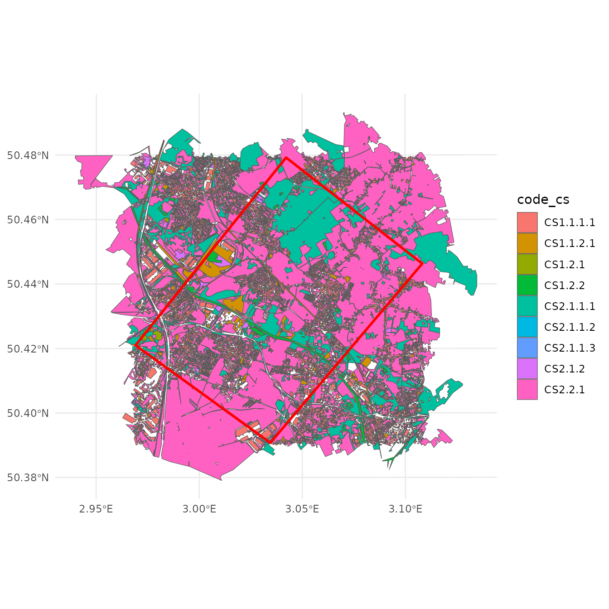

## 2. Habitat layers

### What is a habitat?

A habitat is defined for one species and one activity (feeding,
breeding, moving, etc.). The question you study decides what the habitat
is. For each species, the landscape is split in three kinds of areas:

1.  **Habitat**: areas where the species carries out the activity. Each
    area has a weight that gives its importance.
2.  **Non-habitat**: areas where the species cannot be at all, not even
    to cross them.
3.  **The rest**: areas that are not habitat, but where the species can
    still be present. For example, a road is not a feeding habitat for a
    rabbit, but a rabbit can cross it.

### The `habitat` object

We first select some land cover classes: broadleaved forest
(`CS2.1.1.1`), herbaceous cover (`CS2.2.1`) and mineral surfaces
(`CS1.1.2.1`).

``` r

layer_CS2111 = ocsge_metaleurop[ocsge_metaleurop$code_cs == "CS2.1.1.1", ]
layer_CS221 = ocsge_metaleurop[ocsge_metaleurop$code_cs == "CS2.2.1", ]
layer_CS1121 = ocsge_metaleurop[ocsge_metaleurop$code_cs == "CS1.1.2.1", ]
```

[`habitat()`](https://qonfluens.github.io/spacemodR/reference/habitat.md)
creates a `habitat` object from an `sf` object. It is an `sf` table with
one row per polygon and two extra columns:

- `habitat`: `TRUE` for a habitat, `FALSE` for a non-habitat,
- `weight`: the weight of the polygon (1 by default).

``` r

habitat_10 = habitat(layer_CS2111)
plot(habitat_10)
```


The same weight can be given to all polygons:

``` r

habitat_11 = habitat(layer_CS2111, weight = 0.2)
head(habitat_11)
#> Simple feature collection with 1 feature and 4 fields
#> Geometry type: MULTIPOLYGON
#> Dimension:     XY
#> Bounding box:  xmin: 697049.4 ymin: 7032094 xmax: 709595.3 ymax: 7043419
#> Projected CRS: RGF93 v1 / Lambert-93
#>   habitat weight priority touches                       geometry
#> 1    TRUE    0.2        1    TRUE MULTIPOLYGON (((697891.4 70...
```

Or one value per polygon, for `habitat` and for `weight`. Random values
are used here only to show the result:

``` r

habitat_12 = habitat(
  layer_CS2111,
  habitat = sample(c(TRUE, FALSE), nrow(layer_CS2111), replace = TRUE),
  weight = runif(nrow(layer_CS2111), 0, 10)
)
plot(habitat_12)
```

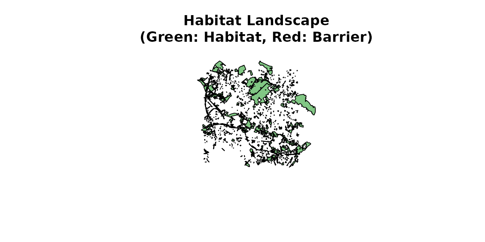

### Adding layers one by one

A habitat is often made of several layers. It is then easier to start
from an empty object and to add the layers one after the other:

- [`add_habitat()`](https://qonfluens.github.io/spacemodR/reference/add_habitat.md)
  adds polygons as habitat, with a weight,
- [`add_nohabitat()`](https://qonfluens.github.io/spacemodR/reference/add_nohabitat.md)
  adds polygons as non-habitat.

``` r

habitat_20 = habitat() |>
  add_habitat(layer_CS2111)
class(habitat_20)
#> [1] "habitat"    "sf"         "data.frame"
```

``` r

habitat_21 = habitat() |>
  add_habitat(layer_CS2111, weight = 0.2)
head(habitat_21)
#> Simple feature collection with 1 feature and 4 fields
#> Geometry type: MULTIPOLYGON
#> Dimension:     XY
#> Bounding box:  xmin: 697049.4 ymin: 7032094 xmax: 709595.3 ymax: 7043419
#> Projected CRS: RGF93 v1 / Lambert-93
#>   habitat weight priority touches                       geometry
#> 1    TRUE    0.2        1    TRUE MULTIPOLYGON (((697891.4 70...
```

``` r

habitat_22 = habitat() |>
  add_habitat(layer_CS2111, weight = 0.2) |>
  add_habitat(layer_CS1121, weight = 0.4) |>
  add_nohabitat(layer_CS221)

head(habitat_22)
#> Simple feature collection with 3 features and 4 fields
#> Geometry type: MULTIPOLYGON
#> Dimension:     XY
#> Bounding box:  xmin: 695704.7 ymin: 7031268 xmax: 709595.3 ymax: 7043983
#> Projected CRS: RGF93 v1 / Lambert-93
#>   habitat weight priority touches                       geometry
#> 1    TRUE    0.2        1    TRUE MULTIPOLYGON (((697891.4 70...
#> 2    TRUE    0.4        2    TRUE MULTIPOLYGON (((698440.6 70...
#> 3   FALSE    0.0        3    TRUE MULTIPOLYGON (((698052.4 70...
```

``` r

plot(habitat_22)
```

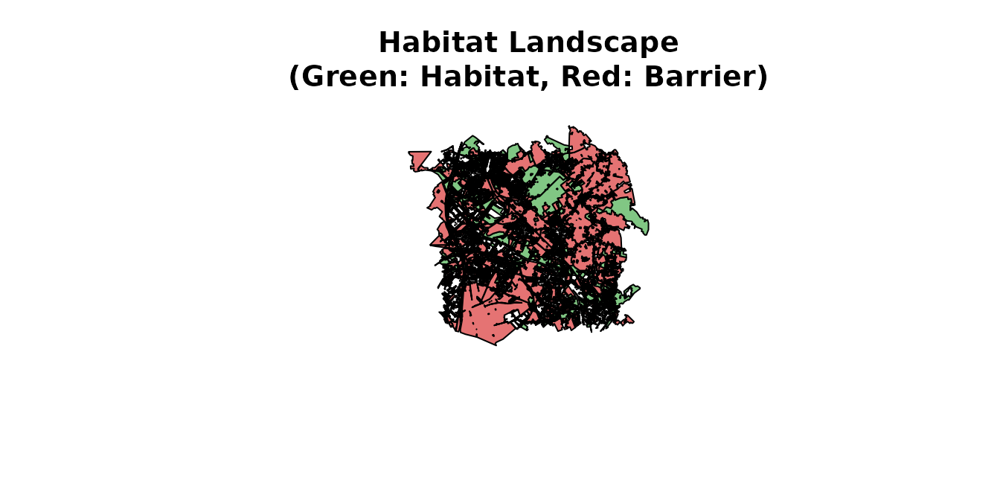

### The soil layer

The soil is the first layer of the model: it is where the contaminant
comes from. The package contains a raster of the cadmium concentration
in the soil of the site (log10 scale).

``` r

ground_cd <- load_raster_extdata("ground_concentration_cd_compressed.tif")
terra::plot(ground_cd)
```


The habitat of the soil layer is built in the same way as for a species.
A list of OCS-GE codes makes the selection easier to read.

``` r

OCSGE_codes <- list(
  forest = c("CS2.1.1.1", "CS2.1.1.2", "CS2.1.1.3", "CS2.1.3"),
  grass = "CS2.2.1",
  water = "CS1.2.2",
  soil = c("CS1.2.1","CS2.1.1.1","CS2.1.1.2","CS2.1.1.3",
           "CS2.1.2","CS2.1.3","CS2.2.1","CS2.2.3"),
  sealed = c("CS1.1.1.1", "CS1.1.1.2", "CS1.1.2.1")
)
```

Natural soils are habitat, sealed surfaces are non-habitat.

``` r

layer_soil_natural = ocsge_metaleurop[ocsge_metaleurop$code_cs %in% OCSGE_codes$soil, ]
layer_soil_artificial = ocsge_metaleurop[ocsge_metaleurop$code_cs %in% OCSGE_codes$sealed, ]

habitat_sol = habitat() |>
  add_habitat(layer_soil_natural) |>
  add_nohabitat(layer_soil_artificial)
plot(habitat_sol)
```

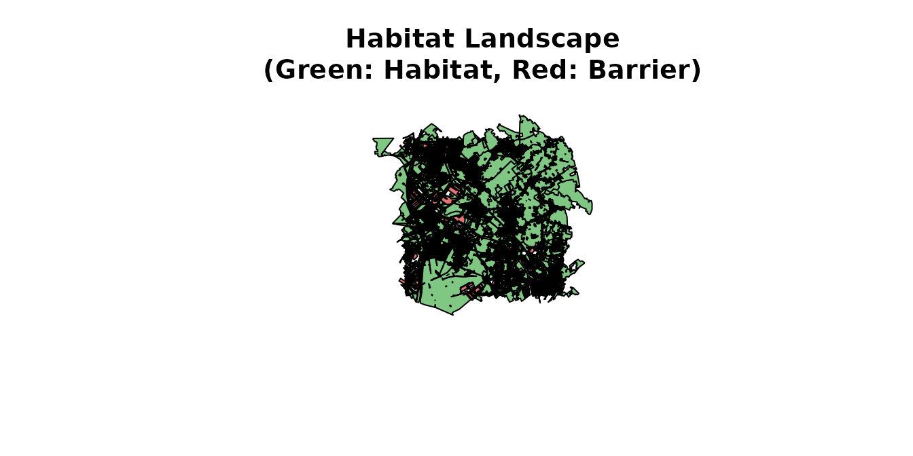

### From polygons to rasters

[`habitat_raster()`](https://qonfluens.github.io/spacemodR/reference/habitat_raster.md)
converts a `habitat` object into a raster. Its first argument is a
reference raster (here `ground_cd`): only its grid is used (resolution,
extent and projection), not its values. In the result:

- habitat pixels take the weight of their polygon,
- non-habitat pixels are `NA`,
- all other pixels are 0.

``` r

rast_sol <- habitat_raster(ground_cd, habitat_sol)
terra::plot(rast_sol)
```

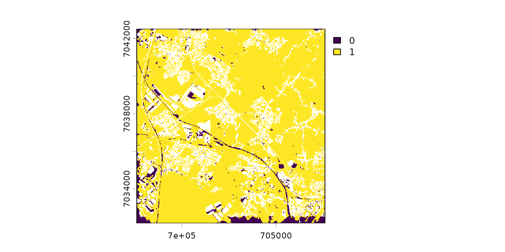

``` r

rast_10 <- habitat_raster(ground_cd, habitat_10)
terra::plot(rast_10)
```

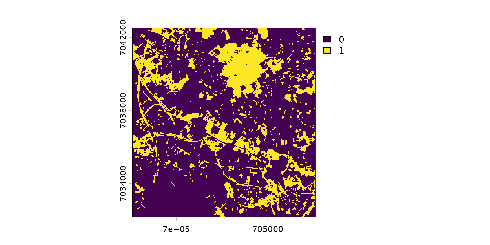

``` r


rast_12 <- habitat_raster(ground_cd, habitat_12)
terra::plot(rast_12)
```

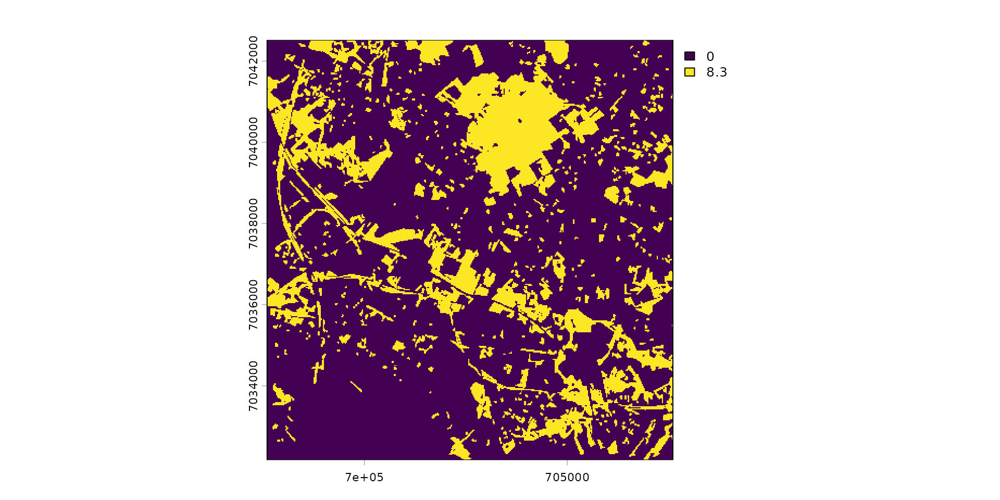

``` r


rast_22 <- habitat_raster(ground_cd, habitat_22)
terra::plot(rast_22)
```

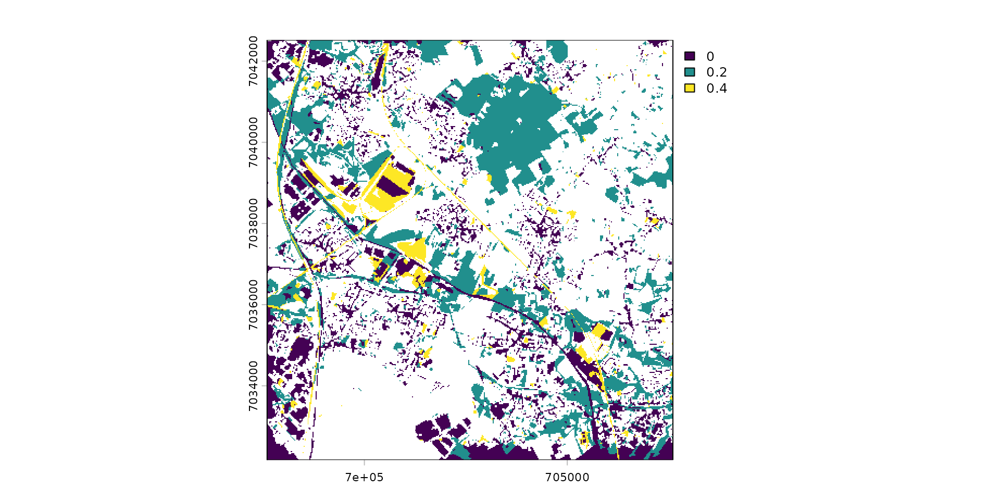

### One stack for all layers

[`raster_stack()`](https://qonfluens.github.io/spacemodR/reference/raster_stack.md)
joins the rasters in one object, with one named layer for the soil and
one for each species.

``` r

stack_habitat <- raster_stack(
  raster_list = list(rast_sol, rast_10, rast_12, rast_22),
  names = c("sol", "sp10", "sp12", "sp22")
)

terra::plot(stack_habitat)
```

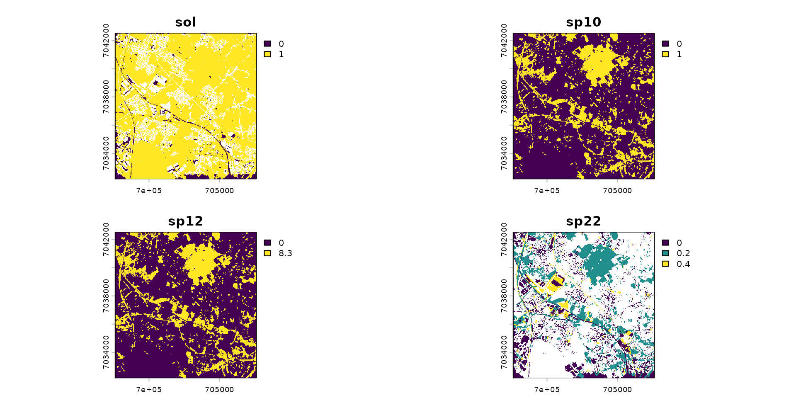

## 3. Food web

The food web says which layer feeds which other layer. Each link goes
from a resource to a consumer and can have a weight. The names must be
the names of the layers of the stack.

A food web can be built from a `data.frame`:

``` r

df_raw <- data.frame(
  src = c("sol", "sol", "sp10", "sp12"),
  target = c("sp10", "sp12", "sp12", "sp22"),
  w = c(2, 3, 2, 1))
trophic_from_df <- trophic(df_raw, from = "src", to = "target", weight = "w")

attr(trophic_from_df, "level")
#>  sol sp10 sp12 sp22 
#>    1    2    3    4
```

Or link by link, with
[`add_link()`](https://qonfluens.github.io/spacemodR/reference/add_link.md):

``` r

trophic_df <- trophic() |>
  add_link("sol", "sp10", 2) |>
  add_link("sol", "sp12", 3) |>
  add_link("sp10", "sp12", 2) |>
  add_link("sp12", "sp22")

attr(trophic_df, "level")
#>  sol sp10 sp12 sp22 
#>    1    2    3    4
```

The attribute `level` gives the trophic level of each layer. The food
web must have no cycle.

[`plot()`](https://rspatial.github.io/terra/reference/plot.html) draws
the food web. With `shift = TRUE`, the trophic levels are shifted along
the horizontal axis so that the arrows do not overlap.

``` r

plot(trophic_df, shift = FALSE)
```

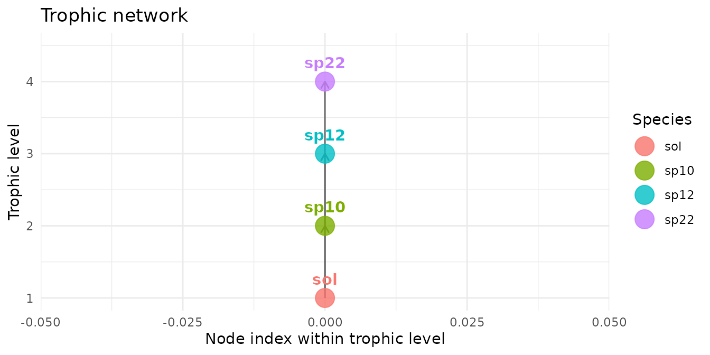

``` r

plot(trophic_df, shift = TRUE)
```

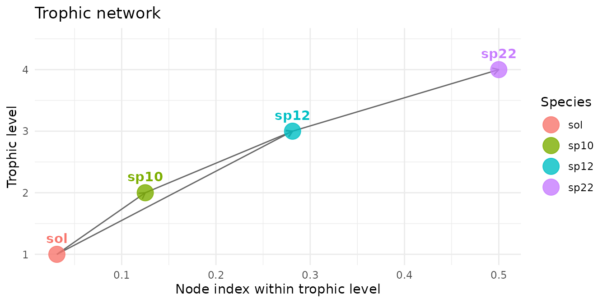

## 4. The spacemodel

A `spacemodel` joins the two objects built above:

- the stack of rasters, one layer for the soil and one for each species,
- the food web that links these layers.

``` r

spcmdl_habitat <- spacemodel(stack_habitat, trophic_df)
```

``` r

color_habitat <- colorRampPalette(c("white", "#169E19"))(255)
terra::plot(spcmdl_habitat, col = color_habitat)
```

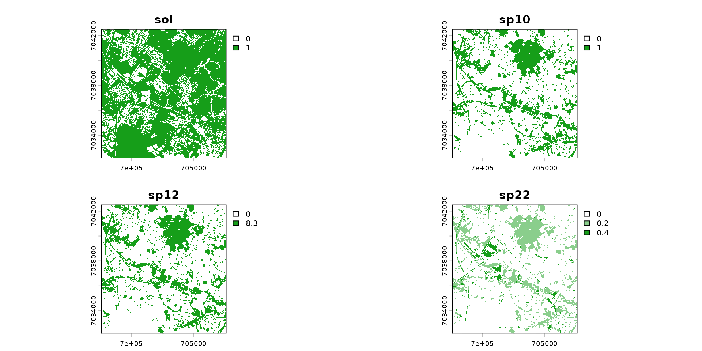

## 5. Dispersal

Animals use the surroundings of their habitat.
[`dispersal()`](https://qonfluens.github.io/spacemodR/reference/dispersal.md)
spreads the habitat of a species around each pixel with a dispersal
kernel. In this version, dispersal does not depend on the food web.

[`compute_kernel()`](https://qonfluens.github.io/spacemodR/reference/compute_kernel.md)
builds a Gaussian kernel from its standard deviation in meters
(`radius`), the pixel size of the raster in meters (`GSD`) and the
number of standard deviations covered on each side (`size_std`).

``` r

k_sp10 <- compute_kernel(radius = 10, GSD = 25, size_std = 1.5)
k_sp12 <- compute_kernel(radius = 100, GSD = 25, size_std = 0.5)
k_sp22 <- compute_kernel(radius = 200, GSD = 25, size_std = 0.1)
```

``` r

spcmdl_dispersal <- spcmdl_habitat |>
  dispersal("sp10", method = "convolution", method_option = list(kernel = k_sp10)) |>
  dispersal("sp12", method = "convolution", method_option = list(kernel = k_sp12)) |>
  dispersal("sp22", method = "convolution", method_option = list(kernel = k_sp22))
```

``` r

color_dispersal <- colorRampPalette(c("white", "#166C9E"))(255)
terra::plot(spcmdl_dispersal, col = color_dispersal)
```

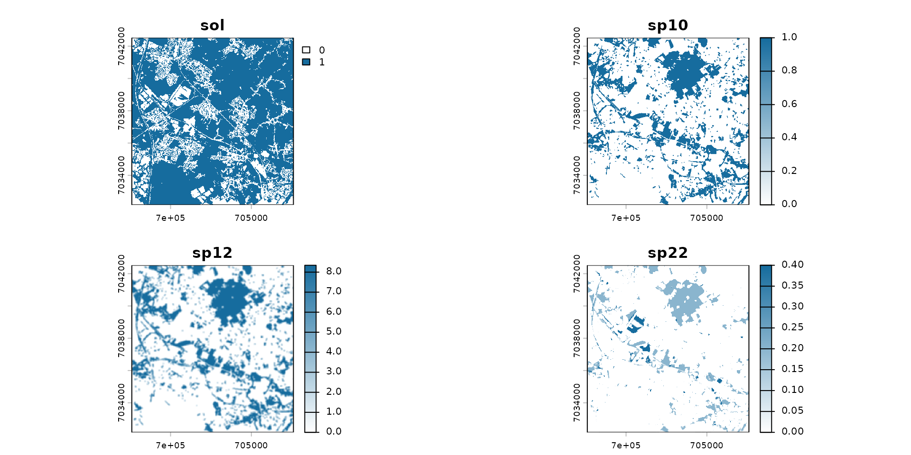

## 6. Exposure

The contaminant now moves from the soil to the species, along the links
of the food web.

First, the soil layer receives the cadmium concentration:

``` r

spcmdl_dispersal[["sol"]][] <- terra::values(ground_cd)
terra::plot(spcmdl_dispersal["sol"])
```

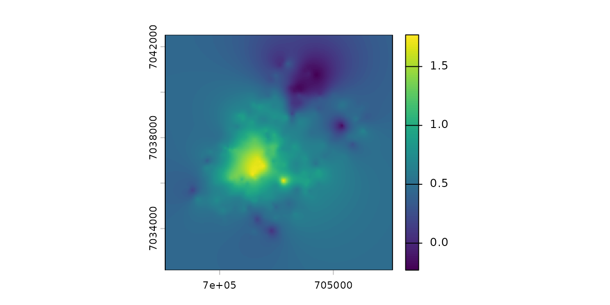

Each consumer looks for its food around its position. This is described
by one kernel per layer (`NA` for the soil, which does not move):

``` r

kernels <- list(
  sol  = NA,
  sp10 = k_sp10,
  sp12 = k_sp12,
  sp22 = k_sp22
)
```

The links of the food web are stored in the spacemodel:

``` r

attr(spcmdl_dispersal, "trophic_tbl")
#>             link weight
#> sp10   sol, sp10      2
#> sp12   sol, sp12      3
#> sp121 sp10, sp12      2
#> sp22  sp12, sp22      1
```

A flux gives, for each link, how the value of the resource becomes the
value of the consumer. It is a number (a coefficient) or a formula of
`x`, the value of the resource.
[`flux()`](https://qonfluens.github.io/spacemodR/reference/flux.md) sets
a default for all links, and
[`add_flux()`](https://qonfluens.github.io/spacemodR/reference/add_flux.md)
changes it for some of them. A rule given with `from` and `to` replaces
a rule given with `to` only.

``` r

test_fluxes <- flux(spcmdl_dispersal, default = 1) |>
  # from the soil to sp10: coefficient 0.4
  add_flux(from = "sol", to = "sp10", value = 0.4) |>
  # all links to sp12: coefficient 0.1
  add_flux(to = "sp12", value = 0.1) |>
  # except when sp12 feeds on sp10: a formula
  add_flux(from = "sp10", to = "sp12", value = ~ x^2/10) |>
  # all links to sp22: a formula
  add_flux(to = "sp22", value = ~ x^0.1)

spcmdl_transfer <- transfer(spcmdl_dispersal, kernels, test_fluxes)
```

``` r

color_transfer <- colorRampPalette(c("white", "#A33D0A"))(255)
terra::plot(spcmdl_transfer, col = color_transfer)
```

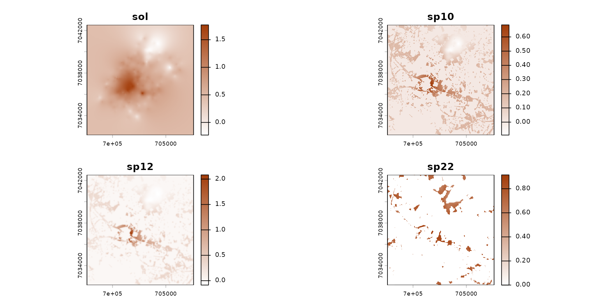

## 7. Risk

The values are on a log10 scale. To compare them with toxicity
thresholds, we go back to concentrations. An operation on a spacemodel
returns a simple stack of rasters, so the food web is attached again
with
[`spacemodel()`](https://qonfluens.github.io/spacemodR/reference/spacemodel.md).

``` r

spcmdl_10 <- 10^spcmdl_transfer
spcmdl_10 <- spacemodel(spcmdl_10, attr(spcmdl_transfer, "trophic_tbl"))
```

The risk index of a layer is its concentration divided by its toxicity
threshold (for example a TRV or a PNEC). An index above 1 means that the
threshold is exceeded. Give the thresholds as a named vector and put
them in the order of the layers before the division.

``` r

# thresholds of each layer (invented values)
thresholds <- c(sol = 1, sp10 = 1.5, sp12 = 1.5, sp22 = 1.5)
# same order as the layers of the spacemodel
ordered_thresholds <- thresholds[names(spcmdl_10)]
# risk index = concentration / threshold
spcmdl_risk <- spcmdl_10 / ordered_thresholds
spcmdl_risk <- spacemodel(spcmdl_risk, attr(spcmdl_transfer, "trophic_tbl"))
```

``` r

breaks_risk <- c(0, 0.1, 0.5, 1, 5, 10, Inf)
cols_risk <- c(
  "darkgreen",   # 0 - 0.1
  "green",       # 0.1 - 0.5
  "lightgreen",  # 0.5 - 1
  "yellow",      # 1 - 5
  "saddlebrown", # 5 - 10
  "#4A2C2A"      # > 10
)
terra::plot(spcmdl_risk,
            breaks = breaks_risk,
            col = cols_risk)
```

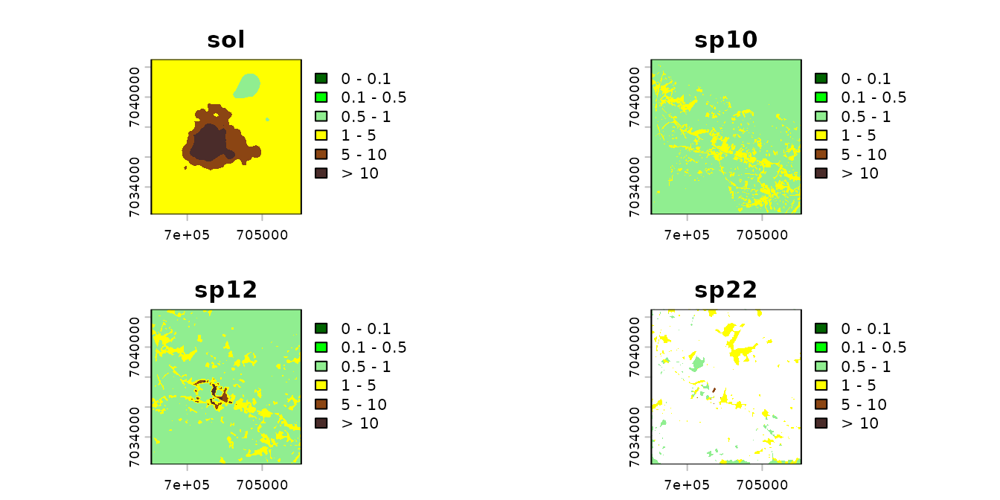

## Going further

The articles of the [package
website](https://qonfluens.github.io/spacemodR/) give more details on
each step: soil maps by kriging, habitat layers and their data sources,
connectivity with Omniscape, food intake, and the estimation of transfer
parameters from field data.
