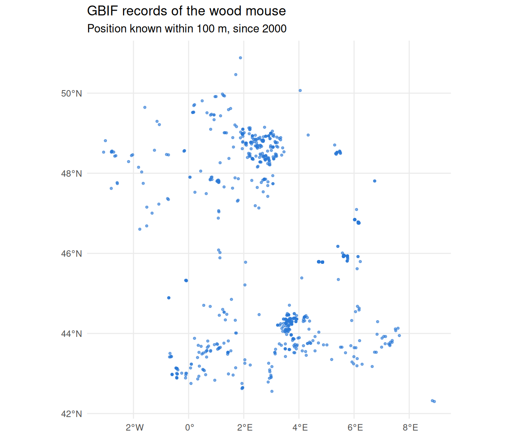
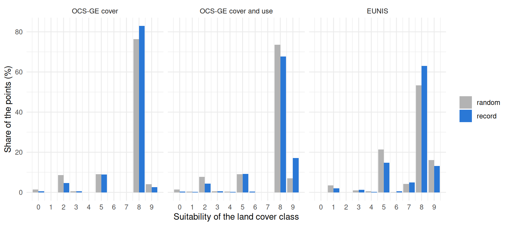
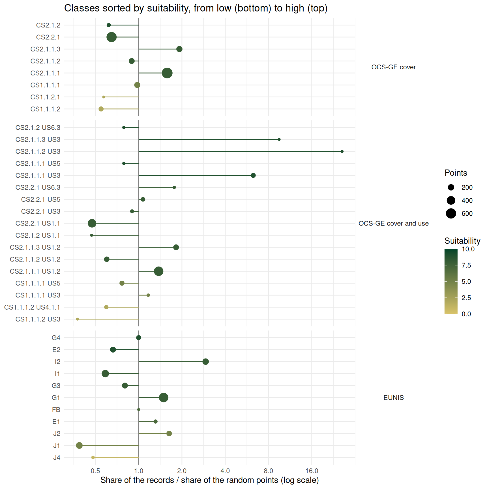

# Species Occurrences (GBIF)

## Introduction

The habitat scores of `spacemodR` come from expert knowledge: they say
where a species *should* live. Occurrence records say where the species
*was seen*. Comparing the two is a simple way to check a habitat layer.

[GBIF](https://www.gbif.org) (Global Biodiversity Information Facility)
is the largest open database of occurrence records. It gathers museum
specimens, field surveys and observations from citizen science
platforms.

This guide has two parts:

1.  how to download records with
    [`get_gbif_data()`](https://qonfluens.github.io/spacemodR/reference/get_gbif_data.md);
2.  a worked example with the wood mouse (*Apodemus sylvaticus*) in
    France, where the records are compared with the habitat scores from
    EUNIS and OCS-GE (see [Habitat Data
    Sources](https://qonfluens.github.io/spacemodR/articles/core_Habitat_Sources.md)).

``` r

library(spacemodR)
library(sf)
library(dplyr)
library(tidyr)
library(ggplot2)
```

## Downloading records

### A first request

[`get_gbif_data()`](https://qonfluens.github.io/spacemodR/reference/get_gbif_data.md)
needs the name of a species. A region of interest is optional. No
account and no key are needed.

``` r

roi <- st_as_sfc(st_bbox(c(xmin = 2.0, ymin = 49.95, xmax = 4.3, ymax = 51.1), crs = 4326))
occ <- get_gbif_data("Apodemus sylvaticus", roi = roi)
```

The function does three things:

1.  it looks for the name in the GBIF taxonomy. Underscores are read as
    spaces, so the names of the species dictionaries
    (`"Apodemus_sylvaticus"`) work too;
2.  it downloads the records found in the bounding box of `roi`, by
    pages of 300;
3.  it keeps the records that are inside `roi`.

The result is an `sf` object of points in longitude and latitude
(EPSG:4326), with one row for each record:

| Column | Meaning |
|----|----|
| `key` | GBIF identifier of the record |
| `species` | Scientific name |
| `coordinateUncertaintyInMeters` | Uncertainty of the position, often missing |
| `eventDate`, `year` | Date and year of the observation |
| `basisOfRecord` | Type of record: observation, museum specimen, … |
| `datasetKey` | GBIF identifier of the dataset that holds the record |
| `license` | License of the record |

Only records with coordinates, and without a known problem on these
coordinates, are returned.

### How many records

By default the function stops after 1000 records. The argument `limit`
changes this number. The total number of records that match the request
is stored as an attribute of the result, so you can check if you got all
of them:

``` r

nrow(occ)
attr(occ, "gbif_count")
```

### Filters

Any filter of the [GBIF occurrence
search](https://techdocs.gbif.org/en/openapi/v1/occurrence#/Searching%20occurrences/searchOccurrence)
can be added as a named argument. A range is written `"min,max"`.

``` r

occ <- get_gbif_data(
  "Apodemus sylvaticus",
  roi = roi,
  year = "2000,2026",                       # observed since 2000
  coordinateUncertaintyInMeters = "0,100",  # position known within 100 m
  basisOfRecord = "HUMAN_OBSERVATION"       # no museum specimen
)
```

Without `roi`, the search is made on the whole world. The filter
`country` (two letter code) is then a simple way to work on one country:

``` r

occ <- get_gbif_data("Apodemus sylvaticus", country = "FR", limit = 5000)
```

### Limits to keep in mind

- **Large requests are slow.** The search service of GBIF is made for
  small requests. It never gives more than 100,000 records, and it
  becomes very slow after about 10,000. For a large request, add
  filters, or split the request by year or by region. For a very large
  one, use the download service of GBIF with the function
  `occ_download()` of the `rgbif` package (it needs a free GBIF
  account).
- **Records are not a survey.** They show where people saw the species.
  A place without record is not a place without the species. Records are
  more common near towns, roads and nature reserves, because observers
  are more common there.
- **Positions can be imprecise.** Many records have an uncertainty of
  several kilometers, or no uncertainty at all.
- **Cite the data.** Each record belongs to a dataset with its own
  license (columns `datasetKey` and `license`). For a publication,
  follow the [GBIF citation
  guidelines](https://www.gbif.org/citation-guidelines).

## Example: the wood mouse in France

The wood mouse is one of the most common small mammals in Europe. It
lives in woods, hedges, gardens and fields. In the species dictionaries
it is a generalist: most land cover classes with vegetation have a high
suitability. Do the GBIF records agree with these scores?

### Choosing the scale

To compare a record with a land cover map, the position of the record
must be at least as precise as the map. The EUNIS map has pixels of 100
m, and OCS-GE maps objects of a few meters. So we keep the records with
a position known within 100 m. This filter removes most of the records:

| Records of *Apodemus sylvaticus* in GBIF (October 2026) | Number |
|---------------------------------------------------------|--------|
| France, with coordinates                                | 27,722 |
| Position known within 100 m                             | 1,926  |
| Observed since 2000                                     | 1,636  |
| One record for each location                            | 1,223  |
| Open license (CC0 or CC BY)                             | 1,037  |

One study site is too small for this comparison. Around the Metaleurop
site used in the other guides, only one record has a position known
within 100 m. The right scale here is the whole country. This is also a
light request: with the filters, the records come in a few seconds.

Two more choices were made:

- records before 2000 are removed, because the land cover maps describe
  the landscape of the last years;
- when several records have the same position (a trap line, an observer
  who comes back), one is kept.

The last line of the table is not about ecology. Records with a
non-commercial license (CC BY-NC) are left out so that the table can be
shared with the package.

``` r

occ <- get_gbif_data("Apodemus sylvaticus", limit = 10000, country = "FR",
                     coordinateUncertaintyInMeters = "0,100",
                     year = "2000,2026")

# one record for each location (coordinates rounded to about 1 m)
occ <- occ[!duplicated(round(st_coordinates(occ), 5)), ]
```

### A random point for each record

Records alone are hard to read. If 40% of the records are in woodland,
is it a lot? It depends on how much woodland there is where people look
for mice.

So each record gets a partner: a random point drawn within 2 km around
it. The random point tells what the landscape offers near the record. A
distance of 2 km is more than a wood mouse travels in its daily life,
but it stays in the same landscape, with the same observers.

``` r

radius <- 2000
xy <- st_coordinates(st_transform(occ, 2154))   # Lambert-93, in meters
r <- radius * sqrt(runif(nrow(xy)))
a <- runif(nrow(xy), 0, 2 * pi)
rnd <- st_as_sf(data.frame(x = xy[, 1] + r * cos(a), y = xy[, 2] + r * sin(a)),
                coords = c("x", "y"), crs = 2154)
```

### Land cover under the points

We do not need the land cover of all France, only its class under about
2,400 points. This keeps the work small enough for a laptop (about 15
minutes), if it is divided in the right way.

**EUNIS.** The EEA service gives images of 4096 x 4096 pixels at most.
At 100 m, France does not fit in one image, so it is cut in tiles of 400
km. Each tile is downloaded with
[`get_eunis_data()`](https://qonfluens.github.io/spacemodR/reference/get_eunis_data.md),
the class under the points is read, and the tile is dropped.

``` r

pts <- st_transform(rbind(st_sf(geometry = st_geometry(st_transform(occ, 2154))), rnd), 3035)
pts$code_eunis <- NA_character_
bb <- st_bbox(pts)
tile <- 400000
for (x0 in seq(floor(bb[["xmin"]] / tile) * tile, bb[["xmax"]], by = tile)) {
  for (y0 in seq(floor(bb[["ymin"]] / tile) * tile, bb[["ymax"]], by = tile)) {
    box <- st_as_sfc(st_bbox(c(xmin = x0, ymin = y0, xmax = x0 + tile, ymax = y0 + tile),
                             crs = 3035))
    inside <- which(lengths(st_intersects(pts, box)) > 0)
    if (length(inside) == 0) next
    eunis <- get_eunis_data(box, level = "L2", resolution = 100)
    pts$code_eunis[inside] <- as.character(terra::extract(eunis, terra::vect(pts[inside, ]))[, 2])
  }
}
```

**OCS-GE.** With a FlatGeobuf file,
[`get_ocsge()`](https://qonfluens.github.io/spacemodR/reference/get_ocsge.md)
downloads only the polygons that touch the region of interest. With a
point as region of interest, it returns the polygon under the point. One
request takes one or two seconds.

``` r

fgb_url <- "https://example.com/data/ocsge_france.fgb"
ocsge <- lapply(seq_len(nrow(pts)), function(i) {
  oc <- get_ocsge(pts[i, ], source = "fgb", fgb_url = fgb_url)
  st_drop_geometry(oc)[1, c("code_cs", "code_us")]
})
pts <- cbind(pts, do.call(rbind, ocsge))
```

The script that built the table of this guide is
`raw_data/build_gbif_apsy_france.R` in the source repository. It does
the same steps, with the OCS-GE requests run in parallel and saved by
chunks, so that it can be stopped and started again.

### The table

The result is kept in the source repository
(`inst/extdata/gbif_apsy_france.csv`) and is read here with a small
helper, `load_table_repo()`.

``` r

pts <- load_table_repo("gbif_apsy_france.csv")
pts <- st_as_sf(pts, coords = c("lon", "lat"), crs = 4326)
head(st_drop_geometry(pts)[, c("pair", "type", "code_eunis", "code_cs", "code_us", "year")])
#>   pair   type code_eunis   code_cs code_us year
#> 1    3 record         I2 CS2.1.1.3   US1.2 2026
#> 2   22 record         G1   CS2.2.1   US6.3 2026
#> 3   40 record         J1   CS2.2.1     US5 2025
#> 4   50 record         C1   CS2.2.1     US3 2025
#> 5   52 record         C1   CS2.2.1     US3 2025
#> 6   53 record         C1   CS2.2.1     US3 2025
```

`pair` links a record with its random point, and `type` tells which is
which.

``` r

ggplot(pts[pts$type == "record", ]) +
  geom_sf(colour = "#2a78d6", size = 0.8, alpha = 0.6) +
  theme_minimal() +
  labs(title = "GBIF records of the wood mouse",
       subtitle = "Position known within 100 m, since 2000")
```



The records are not spread evenly. The Paris region and the south have
many of them, and large parts of the country have almost none. This
shows where the observers are, not where the mice are. It is the reason
why each record is compared with a point of its own neighbourhood, and
not with a point taken anywhere in France.

### Habitat scores of the points

Each point now gets the suitability of the wood mouse for its land cover
class. We do it for the three sources of the [Habitat Data
Sources](https://qonfluens.github.io/spacemodR/articles/core_Habitat_Sources.md)
guide. For OCS-GE,
[`join_ocsge_species()`](https://qonfluens.github.io/spacemodR/reference/join_ocsge_species.md)
does the join, with or without the land use. For EUNIS, the join is a
simple match on the class code.

``` r

species <- "Apodemus_sylvaticus"

# OCS-GE, cover only, then cover and use
pts$cover <- join_ocsge_species(pts, species, us_col = NULL)$suitability
pts$cover_use <- join_ocsge_species(pts, species)$suitability

# EUNIS; for a combined code such as "D5/F6", the mean of the two classes
dict <- eunis_species_dict[eunis_species_dict$species_name == species, ]
pts$eunis <- vapply(strsplit(pts$code_eunis, "/"),
                    function(cc) mean(dict$suitability[match(cc, dict$code_eunis)]),
                    numeric(1))
```

A few points have no land cover (they fall in the sea, or outside the
maps). We keep the pairs where both points have the three scores.

``` r

scores <- st_drop_geometry(pts) %>%
  group_by(pair) %>%
  filter(!any(is.na(cover) | is.na(cover_use) | is.na(eunis))) %>%
  ungroup()
n_distinct(scores$pair)
#> [1] 1019
```

### Do the records match the scores?

#### Overall

If the scores are right, records should fall on better classes than
random points. For each source, the table gives the mean suitability of
the two groups, and the share of pairs where the record has a higher, an
equal or a lower score than its random point.

``` r

sources <- c(cover = "OCS-GE cover", cover_use = "OCS-GE cover and use", eunis = "EUNIS")

pairs <- scores %>%
  select(pair, type, all_of(names(sources))) %>%
  pivot_longer(all_of(names(sources)), names_to = "source", values_to = "suitability") %>%
  mutate(source = factor(sources[source], levels = sources))

pairs %>%
  pivot_wider(names_from = type, values_from = suitability) %>%
  group_by(source) %>%
  summarise(mean_record = round(mean(record), 2),
            mean_random = round(mean(random), 2),
            higher = round(100 * mean(record > random)),
            equal = round(100 * mean(record == random)),
            lower = round(100 * mean(record < random)),
            p_value = signif(wilcox.test(record, random, paired = TRUE)$p.value, 2)) %>%
  knitr::kable()
```

| source               | mean_record | mean_random | higher | equal | lower | p_value |
|:---------------------|------------:|------------:|-------:|------:|------:|--------:|
| OCS-GE cover         |        7.41 |        7.12 |     20 |    65 |    15 | 2.7e-04 |
| OCS-GE cover and use |        7.55 |        7.15 |     23 |    61 |    16 | 1.9e-06 |
| EUNIS                |        7.41 |        7.17 |     30 |    45 |    25 | 5.8e-04 |

The match is clear, but small:

- the records are on good habitat: their mean suitability is about 7.5
  on a scale from 0 to 10, with the three sources;
- the random points are almost as good, only 0.2 to 0.4 points below.
  For a generalist like the wood mouse, most of the French countryside
  has a high score, so a random point near a record is usually also on
  good habitat;
- in about half of the pairs, the record and its random point have the
  same score (they are often in the same class). In the other pairs, the
  record wins more often than it loses;
- the difference is not due to chance: the `p_value` column (paired
  Wilcoxon test) is very small for the three sources;
- the land use helps. OCS-GE with the use gives the largest difference
  between records and random points.

The distribution of the scores shows where the small difference comes
from:

``` r

pairs %>%
  mutate(score = round(suitability)) %>%
  count(source, type, score) %>%
  group_by(source, type) %>%
  mutate(share = 100 * n / sum(n)) %>%
  ggplot(aes(score, share, fill = type)) +
  geom_col(position = position_dodge(preserve = "single")) +
  facet_wrap(~source) +
  scale_x_continuous(breaks = 0:10) +
  scale_fill_manual(values = c(random = "grey70", record = "#2a78d6"), name = NULL) +
  theme_minimal() +
  labs(x = "Suitability of the land cover class", y = "Share of the points (%)")
```



Records are less common than random points on the classes with a low
score (0 to 3), which is what the scores predict. But about nine points
out of ten, in both groups, are on classes with a score of 5 or more.

#### Class by class

A mean hides the details. For each class, we compare the share of the
records with the share of the random points. Their ratio is above 1 when
the records are more common in the class than expected from the
landscape around them, and below 1 when they are less common. Classes
with less than 20 points are not shown, because their ratio is not
reliable.

``` r

class_ratio <- function(class, score) {
  data.frame(class = class, type = scores$type, suitability = score) %>%
    group_by(class) %>%
    summarise(suitability = mean(suitability),
              record = sum(type == "record"), random = sum(type == "random")) %>%
    mutate(ratio = (record / sum(record)) / (random / sum(random))) %>%
    filter(record + random >= 20)
}

classes <- bind_rows(
  "OCS-GE cover" = class_ratio(scores$code_cs, scores$cover),
  "OCS-GE cover and use" = class_ratio(paste(scores$code_cs, scores$code_us), scores$cover_use),
  "EUNIS" = class_ratio(scores$code_eunis, scores$eunis),
  .id = "source"
) %>%
  mutate(source = factor(source, levels = sources))
```

``` r

ggplot(classes, aes(ratio, reorder(class, suitability), colour = suitability)) +
  geom_vline(xintercept = 1, colour = "grey50") +
  geom_segment(aes(x = 1, xend = ratio, yend = reorder(class, suitability))) +
  geom_point(aes(size = record + random)) +
  facet_grid(source ~ ., scales = "free_y", space = "free_y") +
  scale_x_log10(breaks = c(0.25, 0.5, 1, 2, 4, 8, 16)) +
  scale_colour_gradient(low = "#d9c36a", high = "#004529", limits = c(0, 10), name = "Suitability") +
  scale_size_area(max_size = 6, name = "Points") +
  theme_minimal() +
  theme(strip.text.y = element_text(angle = 0)) +
  labs(x = "Share of the records / share of the random points (log scale)", y = NULL,
       title = "Classes sorted by suitability, from low (bottom) to high (top)")
```



The table below gives the classes that hold most of the points, for
OCS-GE with the use and for EUNIS.

``` r

data("ref_ocsge")
data("ref_eunis")
labels <- c(setNames(ref_ocsge$nomenclature, ref_ocsge$code_cs),
            setNames(ref_eunis$nomenclature, ref_eunis$code))

classes %>%
  filter(source != "OCS-GE cover", record + random >= 60) %>%
  mutate(label = substr(labels[sub(" .*", "", class)], 1, 40), ratio = round(ratio, 2)) %>%
  arrange(source, desc(ratio)) %>%
  select(source, class, label, suitability, record, random, ratio) %>%
  knitr::kable()
```

| source | class | label | suitability | record | random | ratio |
|:---|:---|:---|---:|---:|---:|---:|
| OCS-GE cover and use | CS2.1.1.1 US3 | Feuillus | 9 | 94 | 15 | 6.27 |
| OCS-GE cover and use | CS2.1.1.3 US1.2 | Mixte | 8 | 102 | 56 | 1.82 |
| OCS-GE cover and use | CS2.1.1.1 US1.2 | Feuillus | 8 | 292 | 212 | 1.38 |
| OCS-GE cover and use | CS2.2.1 US5 | Formations herbacées | 8 | 45 | 42 | 1.07 |
| OCS-GE cover and use | CS1.1.1.1 US5 | Zones bâties | 5 | 49 | 64 | 0.77 |
| OCS-GE cover and use | CS1.1.1.2 US4.1.1 | Zones non bâties | 2 | 28 | 47 | 0.60 |
| OCS-GE cover and use | CS2.1.1.2 US1.2 | Conifères | 8 | 51 | 85 | 0.60 |
| OCS-GE cover and use | CS2.2.1 US1.1 | Formations herbacées | 8 | 127 | 268 | 0.47 |
| EUNIS | I2 | Cultivated areas of gardens and parks | 8 | 155 | 53 | 2.92 |
| EUNIS | J2 | Low density buildings | 5 | 88 | 54 | 1.63 |
| EUNIS | G1 | Broadleaved deciduous woodland | 8 | 300 | 201 | 1.49 |
| EUNIS | E1 | Dry grasslands | 7 | 38 | 29 | 1.31 |
| EUNIS | G4 | Mixed deciduous and coniferous woodland | 9 | 53 | 53 | 1.00 |
| EUNIS | G3 | Coniferous woodland | 8 | 73 | 91 | 0.80 |
| EUNIS | E2 | Mesic grasslands | 9 | 65 | 98 | 0.66 |
| EUNIS | I1 | Arable land and market gardens | 8 | 105 | 179 | 0.59 |
| EUNIS | J1 | Buildings of cities, towns and villages | 5 | 63 | 163 | 0.39 |

What agrees with the scores:

- **broadleaved woodland** (`CS2.1.1.1`, EUNIS `G1`) has a high score
  and holds more records than expected. It is the first habitat of the
  records;
- **sealed ground without buildings** (`CS1.1.1.2`: roads, car parks)
  and **dense built-up areas** (EUNIS `J1`) have low or medium scores
  and hold about half of the records expected, or less.

What does not agree:

- **farmland** is the main disagreement. Herbaceous cover used for
  agriculture (`CS2.2.1 US1.1`) and arable land (EUNIS `I1`) have a
  score of 8, but they hold about half of the records expected. Either
  the score is too high for open fields, or mice are there and nobody
  looks for them in the middle of a field. Both are probably true: the
  wood mouse uses fields, but mostly near hedges and wood edges;
- **coniferous woodland** (`CS2.1.1.2`, EUNIS `G3`) has the same score
  as broadleaved woodland, but fewer records than expected;
- **parks and gardens** (EUNIS `I2`, and woodland with a service or
  leisure use, `US3`) hold three to six times more records than
  expected. Many people walk and take pictures in these places, so this
  is likely an effect of the observers more than a preference of the
  mouse.

### What to take from this example

- GBIF records support the general shape of the scores of the wood
  mouse: records are on classes scored as good habitat, and woodland
  comes first.
- They also point to scores that deserve a second look: farmed land and
  coniferous woodland, both scored 8, hold fewer records than expected.
- They cannot give new scores by themselves. The observer effect (parks,
  gardens, places easy to reach) is as large as the differences between
  classes.
- For a generalist species, this test has little power: almost every
  place is good habitat. It would say more for a specialist, for which
  good and bad classes are both common around the records.
- The comparison is only possible with precise records, and they are
  few. For the wood mouse, 7% of the French records have a position
  known within 100 m. For many species, a single study site will not
  have enough records, and the comparison has to be made at the scale of
  a region or a country, as here.

Records can also be used the other way: as observed sources in a
connectivity model, or to check its output (see [Landscape Connectivity
(Omniscape)](https://qonfluens.github.io/spacemodR/articles/core_Omniscape_Connectivity.md)).
