# Habitat and Connectivity

## Introduction

In this vignette, we explore the database linking OCS-GE (French GIS
layer for Occupation du Sol à Grande Échelle) labels with species
labels.

We will analyze how different land cover types act as habitats with
varying qualities or resistances for different species, starting with
the Wood mouse (Apodemus sylvaticus).

``` r

library(spacemodR)
library(dplyr)
library(ggplot2)
library(terra)
library(tidyterra)
library(sf)
library(leaflet)
library(patchwork)
```

## The database construction

To build the habitat database for spacemod, we transitioned from
traditional static mapping to a dynamic semantic analysis. Here is a
breakdown of how this new methodology compares to previous standards.

### The Original Framework (O’Connor et al., 2024 ; @oconnor2024habitat)

The foundational method described by O’Connor et al. (2024) relies on an
“expert-based” crosswalk to define optimal habitats for European
terrestrial vertebrates. It links a European land systems map—which
accounts for both land cover and land use intensity—to standardized
habitat classifications from GlobCover and the IUCN Red List. This
approach assigns simple, discrete suitability scores: 2 for optimal
habitat, 1 for secondary habitat, and 0 for unsuitable. These scores
were then manually penalized by subtracting points if specific keywords
related to land use intensity or threats (e.g., agricultural
intensification) appeared in the species’ IUCN descriptions. Ultimately,
this generated Area of Habitat (AOH) maps, filtering existing occurrence
maps to show simple presence or absence at a 1 km² resolution.

### The LLM-Assisted Approach for spacemod

Our approach steps away from rigid keyword matching and discrete
scoring, moving toward a semantic analysis of a species’ ecological
requirements.Instead of using the broad European land systems, this
database utilizes the fine-scale French OCS-GE (Occupation du Sol à
Grande Échelle) nomenclature. Each OCS-GE code was enriched with precise
ecological context. For example, paved roads are described as creating a
“barrier effect,” while mineral soils are noted as “thermophilic.”Using
a Large Language Model (Claude Opus), we fed the AI free-text
descriptions of both preferred and avoided habitats (sourced from EEA
databases). The model conceptually analyzed these texts against our
enriched OCS-GE descriptions, with an anchored scale: 0 unused or
avoided, 2 marginal, 5 secondary, 8 main, 10 core habitat.

Instead of a single presence/absence score, the model generates
continuous variables (on a scale of 0 to 10) that capture finer
landscape ecology concepts:

- `suitability`: Overall habitat suitability (closest to the traditional
  AOH score).
- `weight_breeding`: Value of the class as a breeding, nesting, denning
  or larval site.
- `weight_foraging`: Habitat attractiveness specifically for feeding and
  resource acquisition.
- `permeability`: Landscape permeability for species dispersion, which
  accounts for flight, swimming or fossorial habits.
- `resistance`: The impedance or barrier effect of the environment. It
  is derived from `permeability` on a logarithmic scale,
  `10^(2 * (1 - permeability / 10))`: 1 for free movement, 10 for a
  permeability of 5, 100 for an impassable class.

The dictionary has one row per species and OCS-GE cover (`code_us` is
`NA`), and further rows for the (cover, use) pairs where the land use
changes what the cover stands for. This vignette uses the cover alone;
the article [Habitat data
sources](https://qonfluens.github.io/spacemodR/articles/core_Habitat_Sources.md)
shows what the land use and other land cover maps add. The dictionary
covers 935 European species, of which 482 occur in metropolitan France
(column `in_france`).

### The Fundamental Difference

This new method represents a major shift in both scale and
functionality. The original methodology relied on rigid keyword
penalties to output a discrete matrix (0, 1, or 2), answering a simple
question: can the species live in this pixel? By leveraging natural
language understanding, our method generates a continuous matrix (0-10)
that distinguishes between an environment where a species simply
survives, one it actively seeks for food, and one it merely uses for
transit. These variables are specifically designed to be injected into
complex spatial ecological models (such as graph theory or
Circuitscape), offering a much more nuanced view of landscape
connectivity than traditional AOH mapping.

## Defining Habitat

### Weighted species habitat with OCS-GE layer for *Apodemus sylvaticus*

First, we load the necessary datasets provided by spacemodR:

1.  The species dictionary assigning weights to land cover codes.
2.  The OCS-GE nomenclature reference (containing names and specific hex
    colors).
3.  The spatial layer for OCS-GE (here, we use the ocsge_metaleurop
    dataset as our base map).

``` r

# Load the species dict and reference tables
data("ocsge_species_dict")
data("ref_ocsge")

# Load spatial data
data("ocsge_metaleurop") 
sf_ocsge <- ocsge_metaleurop
```

We filter our species dictionary for *Apodemus sylvaticus* and join it
with the reference nomenclature to link the OCS-GE codes to their
descriptive labels and predefined colors.

``` r

# Filter for Apodemus sylvaticus, keeping the rows of the cover alone
dfhab_Apsy <- ocsge_species_dict %>%
  filter(species_name == "Apodemus_sylvaticus", is.na(code_us))

# Join ref_ocsge with the species dictionary on the cover code
df_merged_Apsy <- ref_ocsge %>%
  dplyr::left_join(dfhab_Apsy, by = "code_cs")

# Join with the spatial sf object. Assuming sf_ocsge uses 'code_cs' (without spaces)
sf_Apsy <- sf_ocsge %>%
  dplyr::left_join(df_merged_Apsy, by = "code_cs")
```

#### Understanding Habitat Values

By examining the `suitability` (s), we can classify the landscape into
different habitat qualities for the species:

- Non-habitat area (s = 0):

``` r

df_merged_Apsy %>% 
  filter(suitability == 0) %>%
  pull(nomenclature) %>%
  unique()
#> [1] "Matériaux composites" "Surfaces d'eau"       "Névés et glaciers"
```

- Very Poor habitat (0 \< s \<= 3):

``` r

df_merged_Apsy %>% 
  filter(suitability > 0, suitability <= 3) %>% 
  pull(nomenclature) %>% 
  unique()
#> [1] "Zones non bâties"                "Matériaux minéraux"             
#> [3] "Sols nus"                        "Autres formations non ligneuses"
```

- Poor habitat (3 \< s \<= 7):

``` r

df_merged_Apsy %>% 
  filter(suitability > 3, suitability <= 7) %>% 
  pull(nomenclature) %>% 
  unique()
#> [1] "Zones bâties"
```

- Good habitat (s \> 7):

``` r

df_merged_Apsy %>% 
  filter(suitability > 7) %>% 
  pull(nomenclature) %>% 
  unique()
#> [1] "Feuillus"                               
#> [2] "Conifères"                              
#> [3] "Mixte"                                  
#> [4] "Formations arbustives, sous-arbrisseaux"
#> [5] "Autres formations ligneuses"            
#> [6] "Formations herbacées"
```

#### Static Mapping

We will now visualize the spatial distribution of these metrics. We
produce four maps focusing on Suitability, Foraging Weight, Landscape
Resistance, and finally the standard OCS-GE Land Cover.

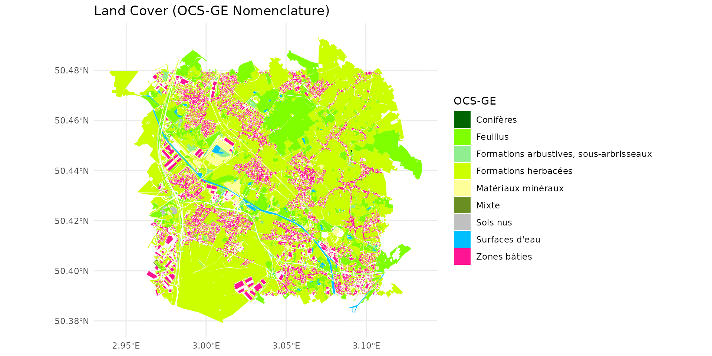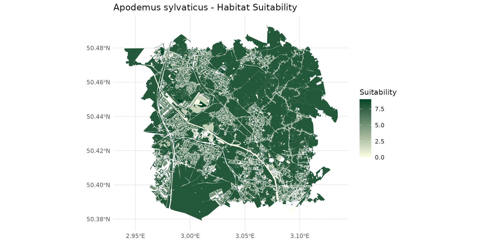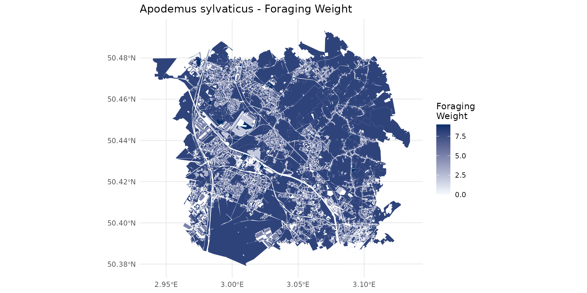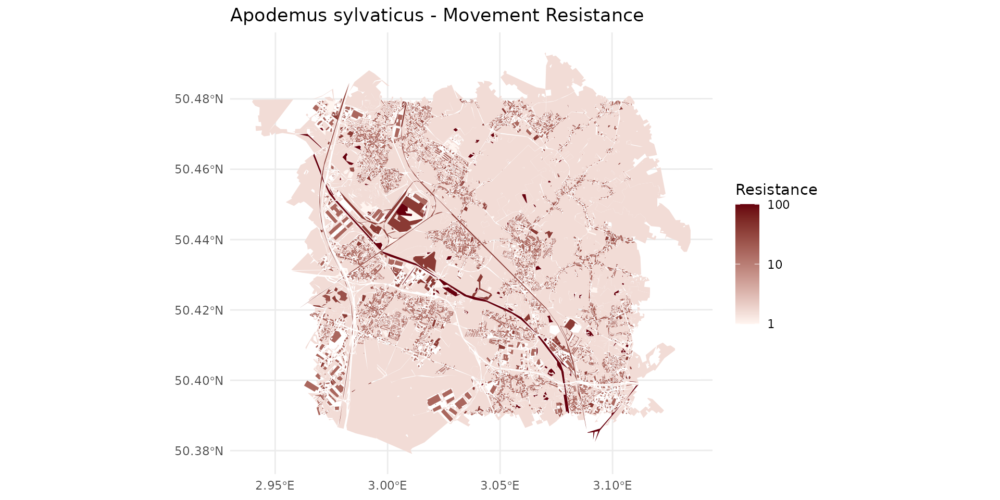

#### Interactive Synthesis

To better explore the local variations and overlay different habitat
parameters for *Apodemus sylvaticus*, we combine them into a single
interactive leaflet map. You can toggle the layers in the top right
corner.

### Multi-species Interactive Synthesis

Different species interact with the landscape in radically different
ways. Below, we create a function to automatically generate the
interactive Leaflet synthesis for any given species, allowing us to
rapidly compare their habitat preferences. \### Turdus merula
(Blackbird)

``` r

turdus_hab <- join_ocsge_species(sf_ocsge, "Turdus_merula")
plot_species_habitat(turdus_hab)
```

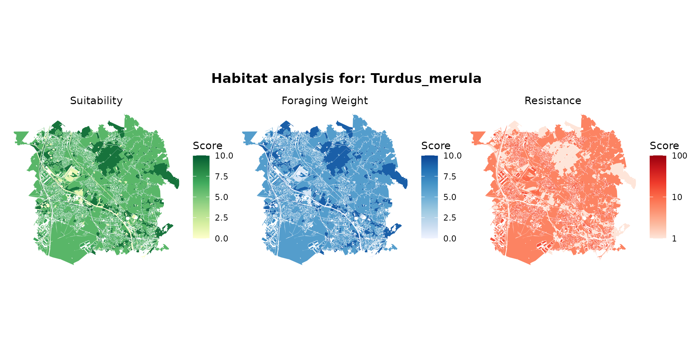

#### Passer domesticus (House Sparrow)

``` r

passer_hab <- join_ocsge_species(sf_ocsge, "Passer_domesticus")
plot_species_habitat(passer_hab)
```

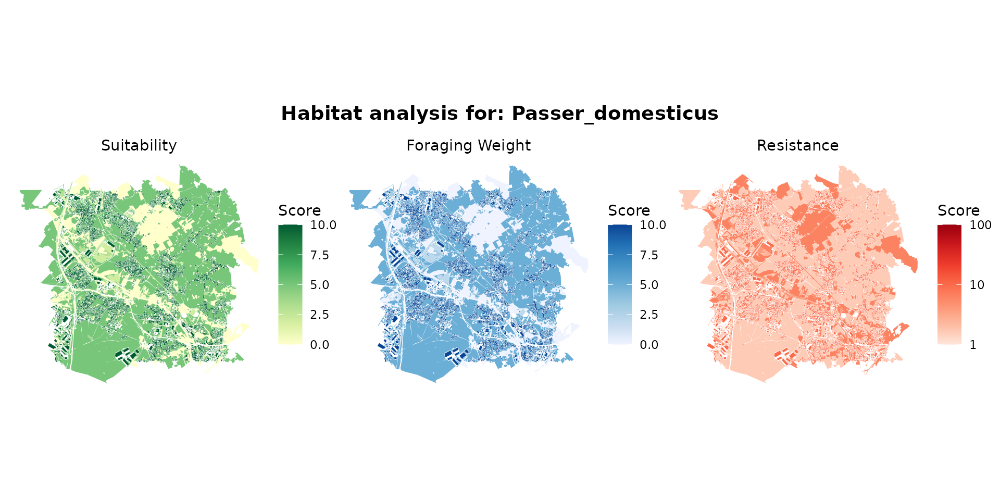

#### Small Mammals (Sorex, Crocidura, Microtus arvalis)

``` r

sorex_hab <- join_ocsge_species(sf_ocsge, "Sorex")
plot_species_habitat(sorex_hab)
```

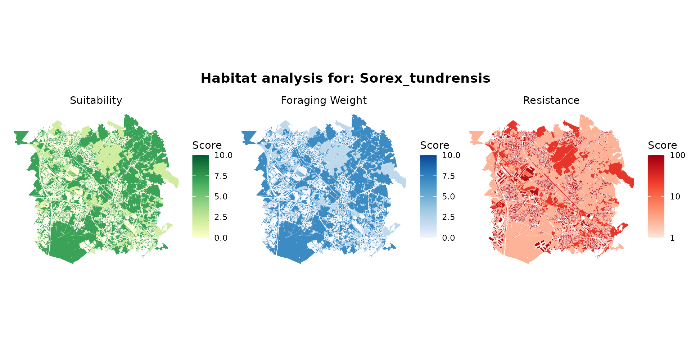

``` r

crocidura_hab <- join_ocsge_species(sf_ocsge, "Crocidura")
plot_species_habitat(crocidura_hab)
```

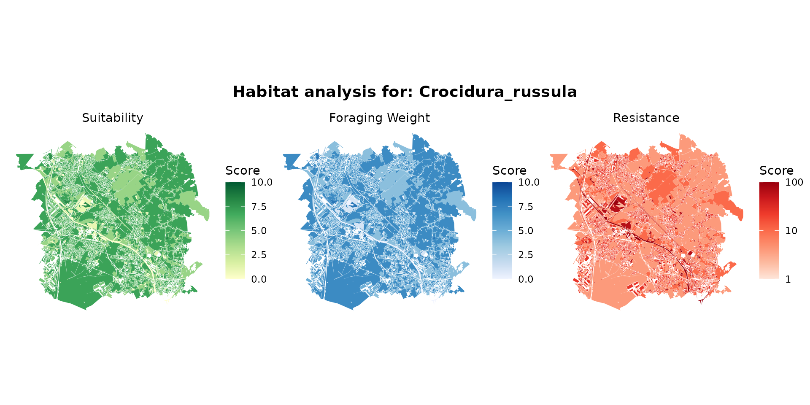

``` r

microtus_hab <- join_ocsge_species(sf_ocsge, "Microtus_arvalis")
plot_species_habitat(microtus_hab)
```

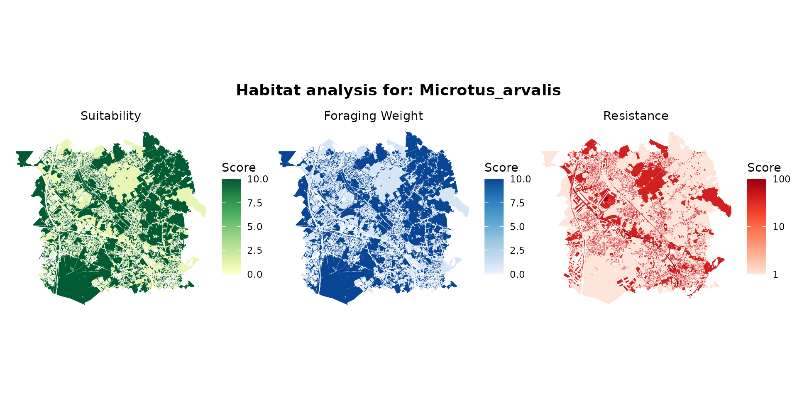

## Connectivity

### From habitat to raster of source and resistance

1.  first step is to collect habitat of the OCS-GE as we did previously

``` r

apsy_hab <- join_ocsge_species(sf_ocsge, "Apodemus_sylvaticus")
plot_species_habitat(apsy_hab)
```

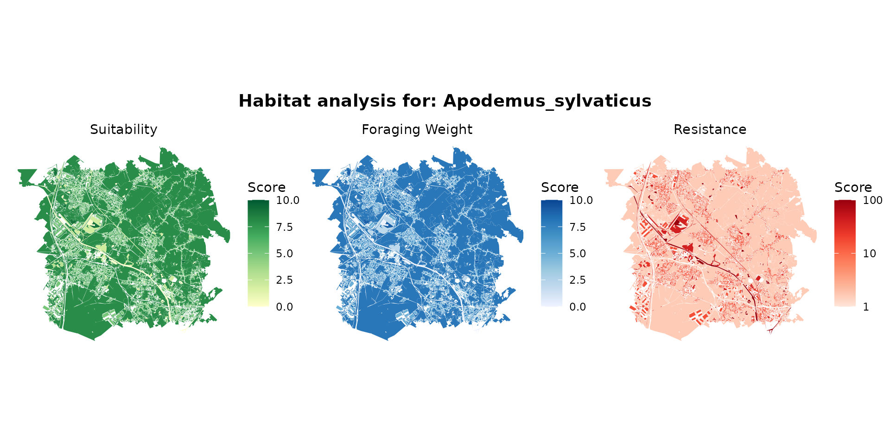

2.  then, we have to create an `habitat` object to benefit from
    `spacemodR` functionalities

``` r

apsy_habitat <- habitat(apsy_hab, habitat=TRUE, weight=apsy_hab$suitability, touches=FALSE)
apsy_resistance <- habitat(apsy_hab, habitat=TRUE, weight=apsy_hab$resistance, touches=FALSE)
```

Here `touches = FALSE` gives each pixel to the land cover class lying
under its centre, which is the right rule for a map of contiguous
polygons. The role of this argument, and of `priority`, is detailed
[below](#stacking-order-and-thin-structures-priority-and-touches).

3.  converting them in raster

``` r

ground_cd <- load_raster_extdata("ground_concentration_cd_compressed.tif")
```

``` r

rast_Apsy_habitat <- habitat_raster(ground_cd, apsy_habitat)
```

The `resistance` of `ocsge_species_dict` is already on the exponential
scale that connectivity models expect, from 1 (free movement) to 100
(impassable): it is derived from the `permeability` score in $`[0-10]`$
as `10^(2 * (1 - permeability / 10))`. A resistance must be at least 1,
so the pixels lying outside the land cover map, which
[`habitat_raster()`](https://qonfluens.github.io/spacemodR/reference/habitat_raster.md)
leaves at 0, are set to 1.

``` r

rast_Apsy_resistance <- habitat_raster(ground_cd, apsy_resistance)
rast_Apsy_resistance <- ifel(rast_Apsy_resistance < 1, 1, rast_Apsy_resistance)
```

``` r

par(mfrow = c(1, 2))
plot(rast_Apsy_habitat, main = "Suitability")
plot(log10(rast_Apsy_resistance), main = "Resistance (log10)")
```

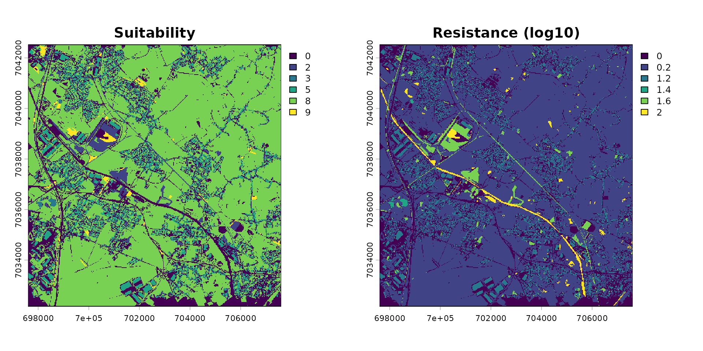

``` r

par(mfrow = c(1, 1))
```

``` r

terra::writeRaster(rast_Apsy_habitat, "julia_run/rast_Apsy_habitat.tif", overwrite = TRUE)
terra::writeRaster(rast_Apsy_resistance, "julia_run/rast_Apsy_resistance.tif", overwrite = TRUE)
```

### Stacking order and thin structures: `priority` and `touches`

A raster holds a single value per pixel, while several features of the
`habitat` object often share the same pixel. Two settings, given layer
by layer in
[`add_habitat()`](https://qonfluens.github.io/spacemodR/reference/add_habitat.md)
and
[`add_nohabitat()`](https://qonfluens.github.io/spacemodR/reference/add_nohabitat.md),
decide what the pixel gets:

- `priority` answers *“which layer wins where layers overlap?”*. The
  layers are stacked from the lowest to the highest priority and the
  pixel takes the value of the layer on top. By default each new layer
  goes on top of the previous ones, so the layers stack in the order
  they are added.
- `touches` answers *“which pixels does a feature occupy?”*. With
  `touches = TRUE` (the default) a line or a polygon fills every pixel
  it touches. With `touches = FALSE` a polygon only fills the pixels
  whose centre it covers, and a line only the pixels of a thin line.

Neither of them describes how hard a structure is to cross: this is the
role of the `weight` (a resistance), or of
[`add_nohabitat()`](https://qonfluens.github.io/spacemodR/reference/add_nohabitat.md)
for an absolute barrier. A river is a barrier for the wood mouse and
hardly an obstacle for a flying insect: this is written in the weights
of two different `habitat` objects, not in `touches`.

#### Example: a watercourse in the landscape of *Apodemus sylvaticus*

Let us zoom on a window of 1 km x 1 km where a channel, narrower than a
pixel (about 25 m), joins a larger canal. Water surfaces are not a
habitat for the wood mouse: we take them out of the land cover and
declare them with
[`add_nohabitat()`](https://qonfluens.github.io/spacemodR/reference/add_nohabitat.md).

``` r

win <- st_as_sfc(st_bbox(
  c(xmin = 700100, xmax = 701100, ymin = 7036400, ymax = 7037400),
  crs = st_crs(apsy_hab)
))
apsy_win <- st_intersection(apsy_hab, win)
grid_win <- crop(ground_cd, vect(win))

water_win <- apsy_win[apsy_win$code_cs == "CS1.2.2", ]
land_win <- apsy_win[apsy_win$code_cs != "CS1.2.2", ]
```

We build the same landscape with three different rules:

``` r

# 1. everything by pixel centre
hab_centre <- habitat() |>
  add_habitat(land_win, weight = land_win$resistance, touches = FALSE) |>
  add_nohabitat(water_win, touches = FALSE)

# 2. water on every touched pixel, but below the land cover
hab_below <- habitat() |>
  add_habitat(land_win, weight = land_win$resistance, touches = FALSE, priority = 2) |>
  add_nohabitat(water_win, touches = TRUE, priority = 1)

# 3. water on every touched pixel, on top of the land cover
hab_top <- habitat() |>
  add_habitat(land_win, weight = land_win$resistance, touches = FALSE, priority = 1) |>
  add_nohabitat(water_win, touches = TRUE, priority = 2)

rast_win <- list(
  "1. pixel centre" = habitat_raster(grid_win, hab_centre),
  "2. touches, water below" = habitat_raster(grid_win, hab_below),
  "3. touches, water on top" = habitat_raster(grid_win, hab_top)
)
```

In the maps below, the excluded pixels (`NA`) are in dark grey and the
outline of the water polygons is drawn in blue.

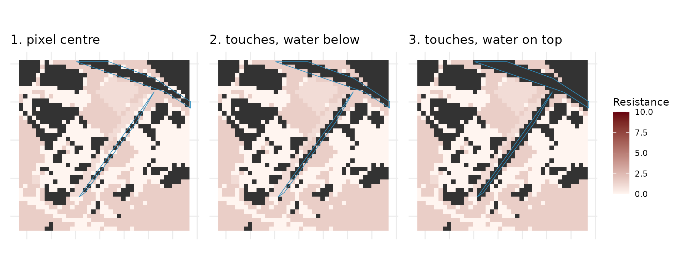

To compare them, we count the excluded pixels, the number of separate
pieces the watercourse is made of, and the number of patches of land a
mouse can reach without crossing water (pixels being neighbours by their
edges and their corners):

``` r

data.frame(
  rule = names(rast_win),
  water_pixels = sapply(rast_win, function(r) sum(is.na(values(r)))),
  water_pieces = sapply(rast_win, function(r) {
    nrow(unique(patches(ifel(is.na(r), 1, NA), directions = 8)))
  }),
  land_patches = sapply(rast_win, function(r) {
    nrow(unique(patches(r, directions = 8)))
  }),
  row.names = NULL
)
#>                       rule water_pixels water_pieces land_patches
#> 1          1. pixel centre           66            6            1
#> 2  2. touches, water below           91            4            2
#> 3 3. touches, water on top          144            1            2
```

1.  **Pixel centre.** The channel only keeps the few pixels whose centre
    falls in it: it is cut into separate pieces, and even the larger
    canal can be crossed diagonally between two of its pixels. The land
    is a single patch: for the model, the water is not a barrier.
2.  **Touches, water below.** The water is drawn on every pixel it
    touches, but the land cover is stacked on top of it and takes back
    all the pixels whose centre it covers. `touches` alone is not
    enough.
3.  **Touches, water on top.** The watercourse is in one piece and the
    canal splits the land in two patches. This is the combination to use
    for a structure that must stay continuous: `touches = TRUE` **and**
    a `priority` above the layers it runs through.

#### Choosing `touches`

`touches = TRUE` has a price: the feature is drawn larger than it is. In
the example the water covers about 4.2 ha, that is 67 pixels: the
pixel-centre rule gives 66 pixels, the third rule 144.

- Use `touches = FALSE` for layers of contiguous polygons covering the
  landscape (a land cover map such as OCS-GE). Their surfaces stay
  unbiased, and with `touches = TRUE` each class would spread over the
  border pixels of its neighbours.
- Keep `touches = TRUE` for the thin structures whose continuity
  matters: barriers (rivers, roads, fences) and corridors (hedgerows,
  banks), whether they are drawn as lines or as narrow polygons, and
  give them a higher `priority`.
- It also applies to structures that are only partly permeable. A river
  added with
  [`add_habitat()`](https://qonfluens.github.io/spacemodR/reference/add_habitat.md)
  and a high resistance must be continuous as well, otherwise it is
  crossed for free wherever it runs obliquely to the grid.

Some situations have no good answer at a given resolution: a structure
narrower than a pixel is either widened to a full pixel or lost, a gap
smaller than a pixel (a bridge) disappears unless it is added as its own
layer with a higher priority, and two structures sharing a pixel (a
hedgerow along a road) cannot both be kept, `priority` only choosing the
winner. When these cases matter, the solution is a finer
`ground_raster`.

### Kernel

### Omniscape

4.  defining a radius

To define the radius, we have to know the real distance radius and then
convert it into number of pixel. Let say, we have a dispersal radius of
500m for *Apodemus sylvaticus*, which is actually quite large for that
species.

Here the map has pixels of 24m, so we use this large value for examples.

For pixel, the size is given by `res(raster)`, here it is a meter
system:

``` r

# get pixel size
terra::res(ground_cd)
#> [1] 24.93766 24.93976
# convert meter radius to pixel radius
m_radius = 500
px_radius = 500 / res(ground_cd)[1]
px_radius
#> [1] 20.05
```

``` bash
docker run --rm \
  -v "$(pwd)/julia_run:/julia_run" \
  spacemodr Rscript /julia_run/run_dispersal.R \
  /julia_run/rast_Apsy_habitat.tif \
  /julia_run/rast_Apsy_resistance.tif \
  20.05 \
  omniscape_apsy_500m
```

``` bash
docker run --rm \
  -v "$(pwd)/julia_run:/julia_run" \
  spacemodr Rscript /julia_run/run_dispersal.R \
  /julia_run/rast_Apsy_habitat.tif \
  /julia_run/rast_Apsy_resistance.tif \
  8.02 \
  omniscape_apsy_200m
```

``` r

p_src = ggplot() +
  theme_minimal() +
  geom_spatraster(data = rast_Apsy_habitat) +
  scale_fill_gradient(low = "#ffffe5", high = "#004529", na.value = "transparent", name = "Suitability") +
  labs(title = "Source")

p_res = ggplot() +
  theme_minimal() +
  geom_spatraster(data = rast_Apsy_resistance) +
  scale_fill_gradient(
    low = "#fff5f0", high = "#67000d", transform="log10",
    na.value = "transparent", name = "Resistance")+
  labs(title = "Resistance")

max_r200m <- global(omniscape_apsy_200m, fun = "max", na.rm = TRUE)
norm_r200m <- omniscape_apsy_200m / as.numeric(max_r200m)
p_omn_200m = ggplot() +
  theme_minimal() +
  geom_spatraster(data = norm_r200m) +
  scale_fill_gradientn(
    colours = c("white", "#11dddd", "#dddd11", "red"),
    trans = "sqrt", 
    na.value = "transparent") +
  labs(title = "Omniscape Connectivity (r=200m)", fill = "Probability")

max_r500m <- global(omniscape_apsy_500m, fun = "max", na.rm = TRUE)
norm_r500m <- omniscape_apsy_500m / as.numeric(max_r500m)
p_omn_500m = ggplot() +
  theme_minimal() +
  geom_spatraster(data = norm_r500m) +
  scale_fill_gradientn(
    colours = c("white", "#11dddd", "#dddd11", "red"),
    trans = "sqrt", na.value = "transparent") +
  labs(title = "Omniscape Connectivity (r=500m)", fill = "Probability")

gridExtra::grid.arrange(p_src, p_res, p_omn_200m, p_omn_500m, ncol=2)
```

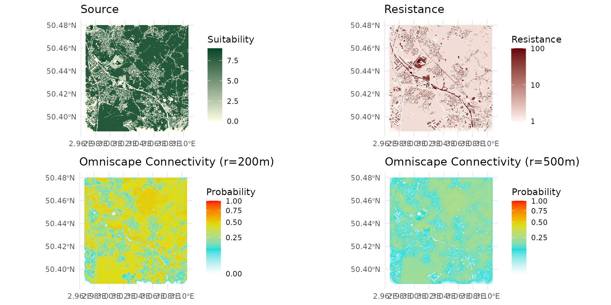
