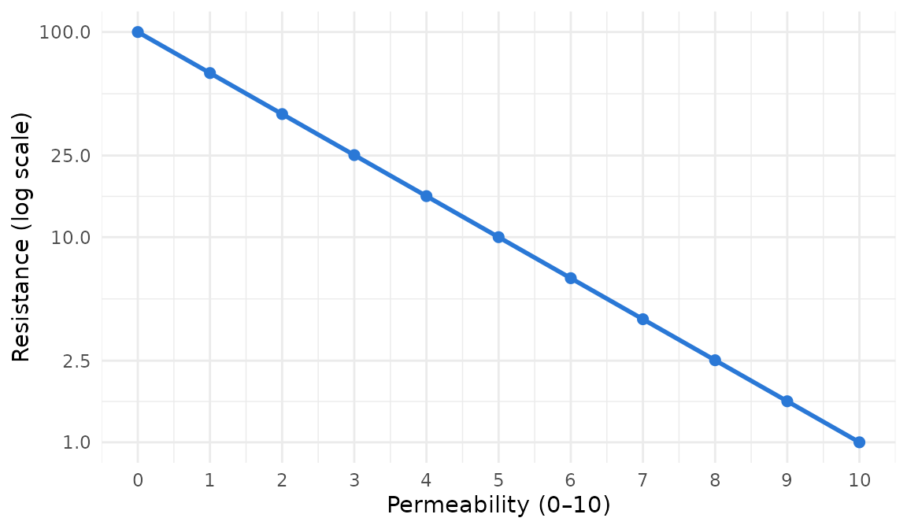
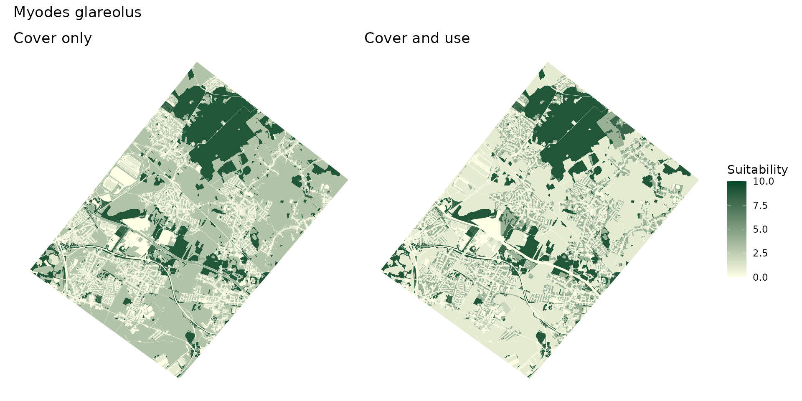
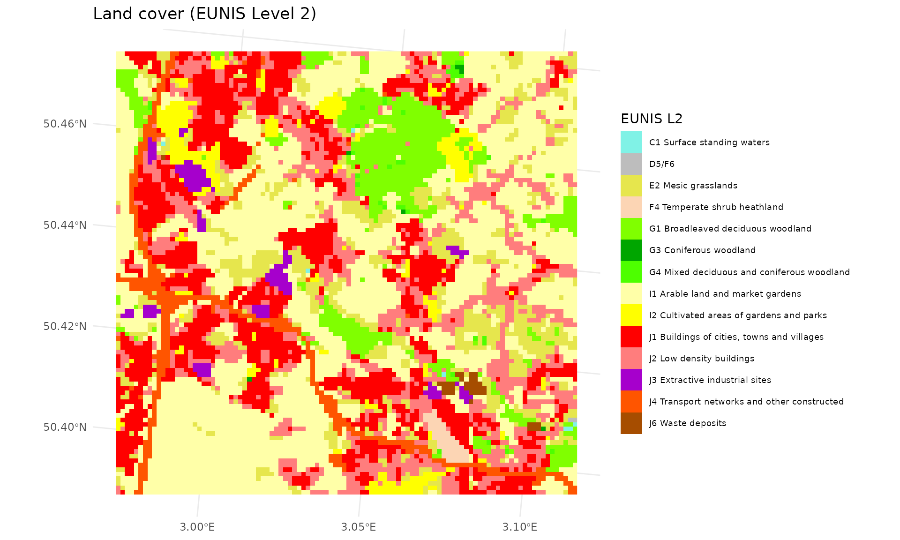
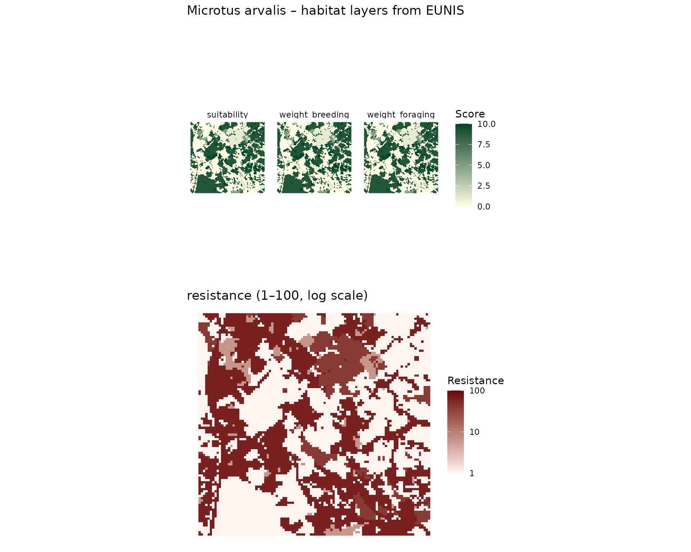
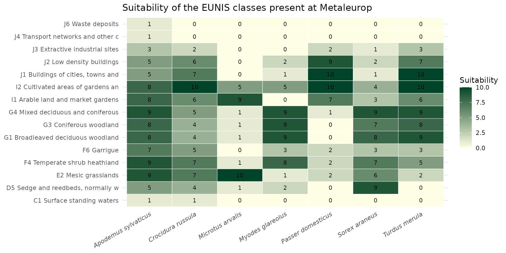
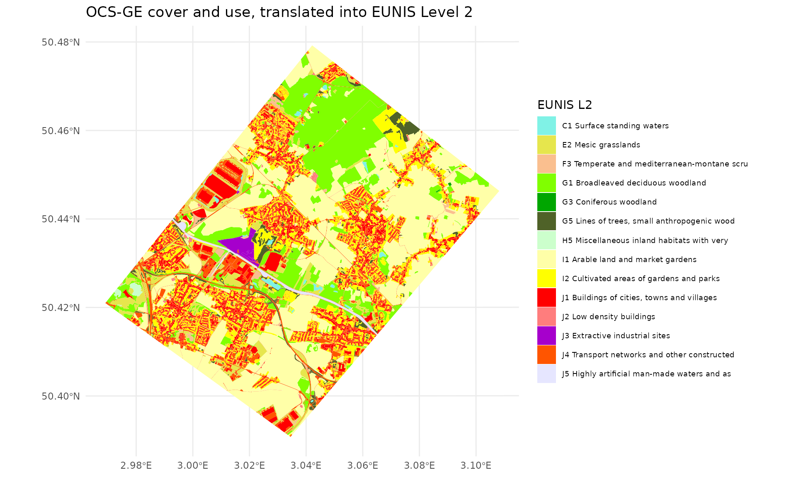
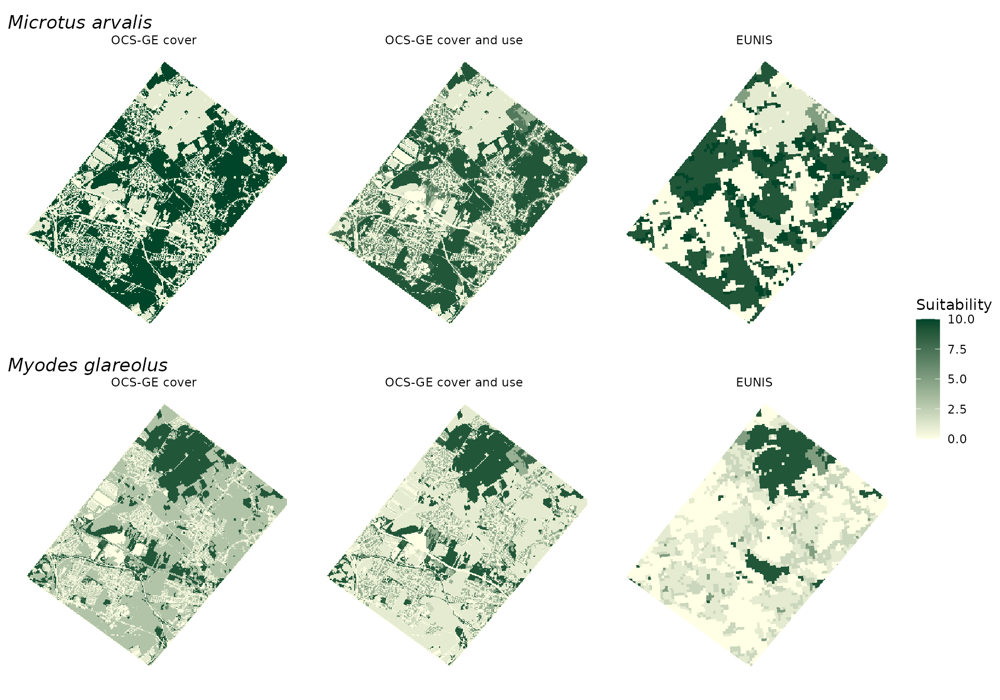

# Habitat Data Sources

## Introduction

A habitat layer tells, for each pixel of the landscape, how good the
place is for a species and how hard it is to cross. In `spacemodR` it is
always built the same way:

1.  a **land cover map**, which splits the landscape into classes;
2.  a **species dictionary**, which gives the scores of a species for
    each class;
3.  a **join** of the two, then a **rasterization** on the grid shared
    with the other layers (soil contamination, for instance).

The [Habitat
Layer](https://qonfluens.github.io/spacemodR/articles/core_Habitat.md)
guide follows these steps with one map and explains how to turn the
result into a `habitat` object. This guide is about step 1: which map to
use, what each one can and cannot tell apart, and how to move from one
to another.

| Source | Extent | Resolution | Classes | Dictionary | Get the data |
|----|----|----|----|----|----|
| OCS-GE, cover (`CS`) | France | vector, about 1:5,000 | 14 | `ocsge_species_dict`, rows with `code_us = NA` | [`get_ocsge()`](https://qonfluens.github.io/spacemodR/reference/get_ocsge.md) |
| OCS-GE, cover and use (`CS` x `US`) | France | vector, about 1:5,000 | 14 covers, refined for 47 (cover, use) pairs | `ocsge_species_dict`, rows with a `code_us` | [`get_ocsge()`](https://qonfluens.github.io/spacemodR/reference/get_ocsge.md) |
| EUNIS Level 2 | 39 EEA countries | raster, 100 m | 45 | `eunis_species_dict` | [`get_eunis_data()`](https://qonfluens.github.io/spacemodR/reference/get_eunis_data.md) |

The table `ref_ocsge_eunis` links the OCS-GE and EUNIS nomenclatures.
Other sources that would refine these maps (agricultural parcels,
vegetation indices, LiDAR) are discussed [at the end](#other-sources).

All examples use the Metaleurop site, and mostly two small mammals with
opposite needs: the common vole (*Microtus arvalis*), a species of open
farmland, and the bank vole (*Myodes glareolus*), a species of woodland
and dense cover.

``` r

library(spacemodR)
library(sf)
library(dplyr)
library(ggplot2)
library(terra)
library(tidyterra)
library(patchwork)
```

## Species dictionaries

### One schema for every source

`ocsge_species_dict` and `eunis_species_dict` cover the same 935
European terrestrial vertebrates and have the same columns. Only the
column holding the land cover class differs.

``` r

data("ocsge_species_dict")
data("eunis_species_dict")
names(ocsge_species_dict)
#>  [1] "code_cs"         "code_us"         "species_name"    "sppID"          
#>  [5] "taxon_group"     "suitability"     "weight_breeding" "weight_foraging"
#>  [9] "permeability"    "resistance"      "habitat_breadth" "specialization" 
#> [13] "confidence"      "in_france"
names(eunis_species_dict)
#>  [1] "code_eunis"      "species_name"    "sppID"           "taxon_group"    
#>  [5] "suitability"     "weight_breeding" "weight_foraging" "permeability"   
#>  [9] "resistance"      "habitat_breadth" "specialization"  "confidence"     
#> [13] "in_france"
```

| Column | Level | Range | Meaning |
|----|----|----|----|
| `code_cs`, `code_us` | class | – | OCS-GE cover and use. `code_us` is `NA` on the rows that score a cover whatever its use. |
| `code_eunis` | class | – | EUNIS Level 2 code, as in `ref_eunis` and in the raster returned by `get_eunis_data(level = "L2")`. |
| `species_name` | species | – | Scientific name, `Genus_species`. |
| `sppID` | species | – | EEA identifier; first letter gives the group (A, R, B, M). |
| `taxon_group` | species | – | amphibian, reptile, bird or mammal. |
| `suitability` | class | 0–10 | Overall habitat quality. **Use as the source / habitat weight.** |
| `weight_breeding` | class | 0–10 | Value as breeding, nesting, denning, roosting or larval site. |
| `weight_foraging` | class | 0–10 | Value for feeding. |
| `permeability` | class | 0–10 | Ease of movement (10 free, 7 readily, 4 reluctantly, 1 strong barrier, 0 impassable). |
| `resistance` | class | 1–100 | `10^(2 * (1 - permeability / 10))`: 10 → 1, 5 → 10, 0 → 100. **Use as the resistance layer.** |
| `habitat_breadth` | species | – | Number of classes with `suitability >= 5` (out of 14 covers or 45 EUNIS classes). |
| `specialization` | species | 0–1 | 1 − normalised Shannon evenness of the suitability profile: 0 generalist, 1 specialist. |
| `confidence` | species | 1–3 | Quality of the source description: 1 vague or empty, 2 medium, 3 detailed. |
| `in_france` | species | 0/1 | 1 if the species occurs natively and regularly in metropolitan France. |

### How the scores were built

The input is the habitat and avoided-habitat description of each species
published by the EEA (O’Connor et al. 2024). A large language model
(Claude Opus) read each description against a short ecological summary
of every class and scored it with the same rules for all sources:

- **Anchored scale.** Every score uses the same reference points (0
  unused or avoided, 2 marginal, 5 secondary, 8 main, 10 core habitat),
  so that a 5 means the same thing for a toad and for an eagle.
- **Breeding separated from foraging.** Many species breed in one
  habitat and feed in another (amphibians in ponds and woods, raptors on
  cliffs and in steppe).
- **Taxon-aware movement.** Flight, swimming and burrowing are taken
  into account, so a road is a strong barrier for a toad but not for a
  kite.
- **Resistance derived, not scored.** Resistance is computed from
  permeability on the 1–100 log scale expected by Omniscape, so the two
  can never contradict each other and no further transformation is
  needed.

``` r

data.frame(permeability = 0:10) %>%
  mutate(resistance = 10^(2 * (1 - permeability / 10))) %>%
  ggplot(aes(permeability, resistance)) +
  geom_line(colour = "#2a78d6", linewidth = 1) +
  geom_point(colour = "#2a78d6", size = 2) +
  scale_y_log10(breaks = c(1, 2.5, 10, 25, 100)) +
  scale_x_continuous(breaks = 0:10) +
  theme_minimal() +
  labs(x = "Permeability (0–10)", y = "Resistance (log scale)")
```



These are expert-judgement values, not values fitted to occurrence data.

### Selecting species

The dictionaries cover Europe. Before working on a French site, keep the
species that occur in France, and check how much is known about them:

``` r

ocsge_species_dict %>%
  distinct(species_name, taxon_group, habitat_breadth, specialization, confidence, in_france) %>%
  filter(in_france == 1, confidence == 3) %>%
  arrange(desc(specialization)) %>%
  head(8)
#>           species_name taxon_group habitat_breadth specialization confidence
#> 1           Uria_aalge        bird               0              1          3
#> 2        Gavia_arctica        bird               1              1          3
#> 3          Gavia_immer        bird               1              1          3
#> 4       Gavia_stellata        bird               1              1          3
#> 5     Podiceps_auritus        bird               1              1          3
#> 6   Podiceps_cristatus        bird               1              1          3
#> 7   Podiceps_grisegena        bird               1              1          3
#> 8 Podiceps_nigricollis        bird               1              1          3
#>   in_france
#> 1         1
#> 2         1
#> 3         1
#> 4         1
#> 5         1
#> 6         1
#> 7         1
#> 8         1
```

## Source 1: OCS-GE land cover (CS)

OCS-GE is the French large-scale land cover database. Its *couverture du
sol* (`CS`) describes what physically covers the ground, in 14 classes.

``` r

data("ocsge_metaleurop")
data("ref_ocsge")
ref_ocsge[, c("code_cs", "nomenclature")]
#>      code_cs                            nomenclature
#> 1  CS1.1.1.1                            Zones bâties
#> 2  CS1.1.1.2                        Zones non bâties
#> 3  CS1.1.2.1                      Matériaux minéraux
#> 4  CS1.1.2.2                    Matériaux composites
#> 5    CS1.2.1                                Sols nus
#> 6    CS1.2.2                          Surfaces d'eau
#> 7    CS1.2.3                       Névés et glaciers
#> 8  CS2.1.1.1                                Feuillus
#> 9  CS2.1.1.2                               Conifères
#> 10 CS2.1.1.3                                   Mixte
#> 11   CS2.1.2 Formations arbustives, sous-arbrisseaux
#> 12   CS2.1.3             Autres formations ligneuses
#> 13   CS2.2.1                    Formations herbacées
#> 14   CS2.2.2         Autres formations non ligneuses
```

The examples below use the layers shipped with the package. For another
site,
[`get_ocsge()`](https://qonfluens.github.io/spacemodR/reference/get_ocsge.md)
returns the polygons of a region of interest, with their `CS` and `US`
codes. It reads them either from the download service of IGN, which
publishes one GeoPackage per department and vintage, or from a
FlatGeobuf file that you host.

``` r

# IGN: the departments of the ROI are downloaded once, then read from a cache
ocsge_site <- get_ocsge(roi_metaleurop, source = "ign", year = 2021)

# FlatGeobuf: only the features of the ROI are downloaded
ocsge_site <- get_ocsge(roi_metaleurop, source = "fgb",
                        fgb_url = "https://example.com/data/ocsge_france.fgb")
```

[`join_ocsge_species()`](https://qonfluens.github.io/spacemodR/reference/join_ocsge_species.md)
adds the scores of a species to the polygons, and
[`plot_species_habitat()`](https://qonfluens.github.io/spacemodR/reference/plot_species_habitat.md)
maps them.

``` r

microtus_cs <- join_ocsge_species(ocsge_metaleurop, "Microtus_arvalis")
plot_species_habitat(microtus_cs)
```


The strength of this source is its geometry: buildings, roads, hedges
and ponds a few meters wide are mapped. Its weakness is that 14 cover
classes say little about habitats. Herbaceous cover (`CS2.2.1`) holds
cereal fields, meadows, lawns, road verges and reedbeds alike, and a
species gets a single score for all of them:

``` r

ocsge_species_dict %>%
  filter(code_cs == "CS2.2.1", is.na(code_us),
         species_name %in% c("Microtus_arvalis", "Myodes_glareolus")) %>%
  select(species_name, code_cs, suitability, weight_foraging, permeability)
#>       species_name code_cs suitability weight_foraging permeability
#> 1 Microtus_arvalis CS2.2.1          10              10           10
#> 2 Myodes_glareolus CS2.2.1           3               3            5
```

## Source 2: OCS-GE land cover and land use (CS x US)

### What the use adds

OCS-GE polygons also carry an *usage du sol* (`US`): agriculture,
forestry, residential, transport networks, and so on. The use does not
describe a habitat by itself, but it tells what a cover stands for. On
the Metaleurop site, herbaceous cover is made of:

``` r

data("ocsge_us_metaleurop")
ocsge_us_metaleurop %>%
  st_drop_geometry() %>%
  filter(code_cs == "CS2.2.1") %>%
  arrange(desc(area_ha)) %>%
  mutate(share = round(100 * area_ha / sum(area_ha)))
#>    code_cs code_us area_ha share
#> 1  CS2.2.1   US1.1 1581.64    62
#> 2  CS2.2.1     US5  523.07    21
#> 3  CS2.2.1     US3  188.80     7
#> 4  CS2.2.1   US6.3  110.41     4
#> 5  CS2.2.1 US4.1.1   48.81     2
#> 6  CS2.2.1     US2   44.53     2
#> 7  CS2.2.1   US4.2   30.03     1
#> 8  CS2.2.1   US1.3    9.76     0
#> 9  CS2.2.1   US4.3    8.56     0
#> 10 CS2.2.1 US4.1.2    2.13     0
#> 11 CS2.2.1   US6.1    0.27     0
```

Crops (`US1.1`, agriculture) make more than half of it, and gardens
(`US5`, residential) about a fifth. `ocsge_species_dict` has rows for
the (cover, use) pairs where the use matters:

``` r

ocsge_species_dict %>%
  filter(code_cs == "CS2.2.1",
         species_name %in% c("Microtus_arvalis", "Myodes_glareolus"),
         is.na(code_us) | code_us %in% c("US1.1", "US1.2", "US3", "US5", "US6.3")) %>%
  select(species_name, code_us, suitability) %>%
  tidyr::pivot_wider(names_from = species_name, values_from = suitability)
#> # A tibble: 6 × 3
#>   code_us Microtus_arvalis Myodes_glareolus
#>   <chr>              <int>            <int>
#> 1 NA                    10                3
#> 2 US1.1                  9                1
#> 3 US1.2                  5                6
#> 4 US3                    7                4
#> 5 US5                    7                4
#> 6 US6.3                  8                1
```

For the bank vole, herbaceous cover is poor habitat as a whole, almost
unused when it is farmed, and secondary habitat when it is a forest
clearing (`US1.2`). The common vole shows the opposite pattern.

Rows with a `code_us` are not scored one by one: each (cover, use) pair
is linked to EUNIS classes by `ref_ocsge_eunis` ([see
below](#moving-between-nomenclatures)) and takes a weighted mean of
their scores in `eunis_species_dict`.

### Joining on cover and use

When the spatial object has a `code_us` column,
[`join_ocsge_species()`](https://qonfluens.github.io/spacemodR/reference/join_ocsge_species.md)
uses it. A polygon takes the scores of its (cover, use) pair when the
dictionary has one, and the scores of its cover otherwise; the column
`use_matched` tells which.

``` r

myodes_us <- join_ocsge_species(ocsge_us_metaleurop, "Myodes_glareolus")

myodes_us %>%
  st_drop_geometry() %>%
  group_by(use_matched) %>%
  summarise(pairs = n(), area_ha = round(sum(area_ha)))
#> # A tibble: 2 × 3
#>   use_matched pairs area_ha
#>   <lgl>       <int>   <dbl>
#> 1 FALSE          40    1961
#> 2 TRUE           28    2841
```

To ignore the use, set `us_col = NULL`. The maps below compare the two
for the bank vole:

``` r

myodes_cs <- join_ocsge_species(ocsge_us_metaleurop, "Myodes_glareolus", us_col = NULL)

map_suit <- function(x, title) {
  ggplot(x) +
    geom_sf(aes(fill = suitability), color = NA) +
    scale_fill_gradient(low = "#ffffe5", high = "#004529", limits = c(0, 10),
                        na.value = "transparent", name = "Suitability") +
    theme_void() +
    labs(title = title)
}
map_suit(myodes_cs, "Cover only") + map_suit(myodes_us, "Cover and use") +
  plot_layout(guides = "collect") +
  plot_annotation(title = "Myodes glareolus")
```



With the cover alone, every field and garden is poor habitat of the same
value. With the use, farmland drops to almost nothing, while gardens,
parks and forest clearings keep some value.

### What the use cannot tell

Some distinctions remain out of reach of OCS-GE, with or without the
use:

- **crops and permanent grassland** share the same cover and the same
  agricultural use;
- **wetlands** (reedbeds, wet meadows, bogs) are not identified;
- **grassland types** (dry, mesic, wet, alpine) are not separated;
- **standing and running water**, **deciduous and evergreen broadleaved
  woodland** are not separated.

## Source 3: EUNIS

### When to use it

EUNIS (European Nature Information System) is a habitat classification.
The EEA *Ecosystem Type Map v3.1* maps it over the 39 EEA countries at
100 m. It is the source to use when:

- the study area is **outside France**;
- the species depends on habitats that OCS-GE cannot separate. EUNIS
  Level 2 has 45 terrestrial classes, including 6 wetland types (D1–D6),
  6 grassland types (E1–E7) and 10 scrub types (F1–FB).

The trade-off is resolution: one pixel of 100 m carries a single
dominant class, so roads, hedges and gardens disappear into their
surroundings.

### The EUNIS land cover layer

[`get_eunis_data()`](https://qonfluens.github.io/spacemodR/reference/get_eunis_data.md)
downloads the EUNIS raster for any region of interest from the EEA map
service. To keep this guide reproducible offline, the Metaleurop layer
is kept in the source repository
(`inst/extdata/eunis_metaleurop_L2.tif`, read here with a small helper,
`load_raster_repo()`); it was produced with:

``` r

data("roi_metaleurop")
eunis_lc <- get_eunis_data(roi_metaleurop, level = "L2", resolution = 100)
```

``` r

data("ref_eunis")
ref_l2 <- ref_eunis %>% filter(level == "L2") %>% select(code, nomenclature, couleur)

eunis_lc <- load_raster_repo("eunis_metaleurop_L2.tif")
lv <- terra::levels(eunis_lc)[[1]]
names(lv) <- c("value", "code")
lv %>% left_join(ref_l2, by = "code") %>% select(code, nomenclature)
#>     code                                                 nomenclature
#> 1     C1                                      Surface standing waters
#> 2  D5/F6                                                         <NA>
#> 3     E2                                             Mesic grasslands
#> 4     F4                                    Temperate shrub heathland
#> 5     G1                               Broadleaved deciduous woodland
#> 6     G3                                          Coniferous woodland
#> 7     G4                      Mixed deciduous and coniferous woodland
#> 8     I1                               Arable land and market gardens
#> 9     I2                        Cultivated areas of gardens and parks
#> 10    J1                      Buildings of cities, towns and villages
#> 11    J2                                        Low density buildings
#> 12    J3                                  Extractive industrial sites
#> 13    J4 Transport networks and other constructed hard-surfaced areas
#> 14    J6                                               Waste deposits
```

The raster is categorical. Note the combined code `"D5/F6"`: the EEA
service draws D5 (sedge and reedbeds) and F6 (garrigue) with the same
color, so these pixels cannot be told apart (see
[`?get_eunis_data`](https://qonfluens.github.io/spacemodR/reference/get_eunis_data.md)).

``` r

eunis_lab <- lv %>%
  left_join(ref_l2, by = "code") %>%
  transmute(value,
            eunis = ifelse(is.na(nomenclature), code, paste(code, substr(nomenclature, 1, 40))),
            couleur = ifelse(is.na(couleur), "#BDBDBD", couleur))
eunis_lc_lab <- eunis_lc
levels(eunis_lc_lab) <- eunis_lab[, c("value", "eunis")]

ggplot() +
  geom_spatraster(data = eunis_lc_lab) +
  scale_fill_manual(values = setNames(eunis_lab$couleur, eunis_lab$eunis),
                    na.value = "transparent", name = "EUNIS L2") +
  theme_minimal() +
  theme(legend.text = element_text(size = 7)) +
  labs(title = "Land cover (EUNIS Level 2)")
```



### From species scores to rasters

The map is a raster, so the join is a reclassification. We write a small
helper that replaces each EUNIS class by a species score. For combined
codes such as `"D5/F6"`, the scores of the two classes are averaged.

``` r

eunis_species_raster <- function(lc, species, var = "suitability",
                                 dict = eunis_species_dict) {
  lv <- terra::levels(lc)[[1]]
  names(lv) <- c("value", "code")
  d <- dict[dict$species_name == species, ]
  if (nrow(d) == 0) stop("Species not found: ", species)
  val <- vapply(strsplit(lv$code, "/"),
                function(cc) mean(d[[var]][match(cc, d$code_eunis)]), numeric(1))
  r <- lc
  levels(r) <- NULL                       # drop categories, keep pixel ids
  out <- terra::classify(r, cbind(lv$value, val))
  names(out) <- var
  out
}
```

``` r

vars <- c("suitability", "weight_breeding", "weight_foraging", "resistance")
microtus_eunis <- rast(lapply(vars, function(v) eunis_species_raster(eunis_lc, "Microtus_arvalis", v)))

p_score <- ggplot() +
  geom_spatraster(data = microtus_eunis[[1:3]]) +
  facet_wrap(~lyr) +
  scale_fill_gradient(low = "#ffffe5", high = "#004529", limits = c(0, 10),
                      na.value = "transparent", name = "Score") +
  theme_void()
p_res <- ggplot() +
  geom_spatraster(data = microtus_eunis[["resistance"]]) +
  scale_fill_gradient(low = "#fff5f0", high = "#67000d", trans = "log10", limits = c(1, 100),
                      na.value = "transparent", name = "Resistance") +
  theme_void() +
  labs(title = "resistance (1–100, log scale)")

p_score / p_res + plot_annotation(title = "Microtus arvalis – habitat layers from EUNIS")
```



### Scores of the classes present on the site

``` r

species <- c("Apodemus_sylvaticus", "Microtus_arvalis", "Myodes_glareolus",
             "Sorex_araneus", "Crocidura_russula", "Turdus_merula", "Passer_domesticus")
present <- unlist(strsplit(lv$code, "/"))

eunis_species_dict %>%
  filter(species_name %in% species, code_eunis %in% present) %>%
  left_join(ref_l2, by = c("code_eunis" = "code")) %>%
  mutate(species_name = gsub("_", " ", species_name),
         label = paste(code_eunis, substr(nomenclature, 1, 30))) %>%
  ggplot(aes(species_name, label, fill = suitability)) +
  geom_tile(colour = "white") +
  geom_text(aes(label = suitability), size = 3) +
  scale_fill_gradient(low = "#ffffe5", high = "#004529", limits = c(0, 10)) +
  theme_minimal() +
  theme(axis.text.x = element_text(angle = 30, hjust = 1, face = "italic")) +
  labs(x = NULL, y = NULL, fill = "Suitability",
       title = "Suitability of the EUNIS classes present at Metaleurop")
```



Arable land (I1), mesic grassland (E2) and gardens and parks (I2) are
three separate classes here, with clearly different values for the two
voles and the shrews. In OCS-GE they are a single cover.

## Moving between nomenclatures

### The OCS-GE / EUNIS crosswalk

OCS-GE and EUNIS do not nest: one describes what covers the ground, the
other describes habitats. `ref_ocsge_eunis` gives, for each OCS-GE cover
and for each (cover, use) pair that deserves it, a ranked list of EUNIS
classes.

``` r

data("ref_ocsge_eunis")

# default EUNIS class of each cover, with the other candidates
ref_ocsge_eunis %>%
  filter(is.na(code_us)) %>%
  group_by(code_cs) %>%
  summarise(default = code_eunis[rank == 1],
            others = paste(code_eunis[rank > 1], collapse = ", ")) %>%
  left_join(ref_ocsge[, c("code_cs", "nomenclature")], by = "code_cs") %>%
  select(code_cs, nomenclature, default, others)
#> # A tibble: 14 × 4
#>    code_cs   nomenclature                            default others             
#>    <chr>     <chr>                                   <chr>   <chr>              
#>  1 CS1.1.1.1 Zones bâties                            J1      "J2"               
#>  2 CS1.1.1.2 Zones non bâties                        J4      "J1, J2"           
#>  3 CS1.1.2.1 Matériaux minéraux                      J4      "J3, J1, J6, H5"   
#>  4 CS1.1.2.2 Matériaux composites                    J6      ""                 
#>  5 CS1.2.1   Sols nus                                H5      "H3, H2, B1, B2, B…
#>  6 CS1.2.2   Surfaces d'eau                          C1      "C2, J5, C3"       
#>  7 CS1.2.3   Névés et glaciers                       H4      ""                 
#>  8 CS2.1.1.1 Feuillus                                G1      "G2, G5"           
#>  9 CS2.1.1.2 Conifères                               G3      "G5"               
#> 10 CS2.1.1.3 Mixte                                   G4      "G5"               
#> 11 CS2.1.2   Formations arbustives, sous-arbrisseaux F3      "F4, F5, F6, F9, F…
#> 12 CS2.1.3   Autres formations ligneuses             FB      ""                 
#> 13 CS2.2.1   Formations herbacées                    I1      "E2, I2, E1, E3, E…
#> 14 CS2.2.2   Autres formations non ligneuses         D1      "D2, D4, F1, D3"
```

Rows with a `code_us` refine the match, for instance for herbaceous
cover:

``` r

ref_ocsge_eunis %>%
  filter(code_cs == "CS2.2.1", !is.na(code_us), rank <= 2) %>%
  select(code_us, rank, code_eunis, pct_metaleurop, note) %>%
  knitr::kable()
```

| code_us | rank | code_eunis | pct_metaleurop | note |
|:---|---:|:---|---:|:---|
| US1.1 | 1 | I1 | 76 | Arable crops. Crops and permanent grassland share this cover and use: the RPG (Registre Parcellaire Graphique) is needed to separate them |
| US1.1 | 2 | E2 | 14 | Permanent pastures and hay meadows |
| US1.2 | 1 | G5 | NA | Clear-cuts, forest rides and firebreaks (recently felled woodland) |
| US1.2 | 2 | E2 | NA |  |
| US1.3 | 1 | J3 | NA | Grassed parts of extraction sites |
| US1.3 | 2 | E2 | NA |  |
| US2 | 1 | E2 | 14 | Lawns of industrial sites (EUNIS E2.6) |
| US2 | 2 | I2 | 1 |  |
| US3 | 1 | I2 | 32 | Parks, sports grounds, cemeteries, campuses |
| US3 | 2 | E2 | 15 | Sports fields and large lawns (EUNIS E2.6) |
| US5 | 1 | I2 | 1 | Domestic gardens |
| US5 | 2 | E2 | 5 |  |
| US235 | 1 | I2 | NA | Gardens and green spaces of mixed urban areas |
| US235 | 2 | E2 | NA |  |
| US4.1.1 | 1 | E2 | 9 | Road verges and embankments |
| US4.1.1 | 2 | J4 | 47 |  |
| US4.1.2 | 1 | E2 | NA | Railway verges and embankments |
| US4.1.2 | 2 | J4 | NA |  |
| US4.1.3 | 1 | E2 | NA | Airfield grass |
| US4.1.3 | 2 | J4 | NA |  |
| US4.2 | 1 | E2 | 9 | Lawns of logistics sites |
| US4.3 | 1 | E2 | NA | Grass of utility networks (power-line corridors, dykes, basins) |
| US6.2 | 1 | E2 | NA | Abandoned grassland and herbaceous wasteland |
| US6.2 | 2 | I1 | NA | Recently abandoned arable land (EUNIS I1.5) |
| US6.3 | 1 | E2 | 24 | Unmanaged grassland. The grassland type (dry, mesic, wet, alpine) needs soil moisture or altitude data |
| US6.3 | 2 | E1 | 0 |  |

`rank` is an expert reading of the two nomenclatures. `pct_metaleurop`
is a measurement: the share of the area of each OCS-GE group that falls
in the EUNIS class on this site. The two do not always agree, because of
the 100 m pixel of the EUNIS map: gardens (`US5`) are `I2` by
definition, but they are too small to be the dominant class of a pixel,
which is then classified as buildings.

The column `main_cs` gives the opposite direction, the main OCS-GE cover
of each EUNIS class:

``` r

ref_ocsge_eunis %>%
  filter(main_cs) %>%
  group_by(code_cs) %>%
  summarise(eunis = paste(code_eunis, collapse = ", "))
#> # A tibble: 14 × 2
#>    code_cs   eunis                                             
#>    <chr>     <chr>                                             
#>  1 CS1.1.1.1 J1, J2                                            
#>  2 CS1.1.1.2 J4                                                
#>  3 CS1.1.2.1 J3                                                
#>  4 CS1.1.2.2 J6                                                
#>  5 CS1.2.1   H5, H3, H2, B1, B2, B3                            
#>  6 CS1.2.2   C1, C2, J5                                        
#>  7 CS1.2.3   H4                                                
#>  8 CS2.1.1.1 G1, G2, G5                                        
#>  9 CS2.1.1.2 G3                                                
#> 10 CS2.1.1.3 G4                                                
#> 11 CS2.1.2   F3, F4, F5, F6, F9, F2, F7, F8                    
#> 12 CS2.1.3   FB                                                
#> 13 CS2.2.1   I1, E2, I2, E1, E3, E4, E7, D5, C3, D2, D4, D6, E6
#> 14 CS2.2.2   D1, F1, D3
```

### Translating a map

The crosswalk translates OCS-GE polygons into EUNIS classes, taking the
(cover, use) pair when it is listed and the cover otherwise. This gives
a EUNIS map with the geometry of OCS-GE:

``` r

best <- ref_ocsge_eunis %>% filter(rank == 1)
with_us <- best$code_eunis[match(paste(ocsge_us_metaleurop$code_cs, ocsge_us_metaleurop$code_us),
                                 paste(best$code_cs, best$code_us))]
cs_only <- best$code_eunis[match(paste(ocsge_us_metaleurop$code_cs, NA),
                                 paste(best$code_cs, best$code_us))]
ocsge_as_eunis <- ocsge_us_metaleurop %>%
  mutate(code_eunis = ifelse(is.na(with_us), cs_only, with_us)) %>%
  left_join(ref_l2, by = c("code_eunis" = "code")) %>%
  mutate(eunis = paste(code_eunis, substr(nomenclature, 1, 40)))

ggplot(ocsge_as_eunis) +
  geom_sf(aes(fill = eunis), color = NA) +
  scale_fill_manual(values = setNames(ocsge_as_eunis$couleur, ocsge_as_eunis$eunis), name = "EUNIS L2") +
  theme_minimal() +
  theme(legend.text = element_text(size = 7)) +
  labs(title = "OCS-GE cover and use, translated into EUNIS Level 2")
```



Compare with the EEA map above: the classes are the same, the grain is
not.

## Comparing the sources

To compare the three sources, we bring them onto the grid of the soil
contamination raster (25 m).

``` r

ground_cd <- load_raster_extdata("ground_concentration_cd_compressed.tif")

ocsge_score_raster <- function(x, var = "suitability") {
  habitat_raster(ground_cd, habitat(x, habitat = TRUE, weight = x[[var]], touches = FALSE))
}
compare_sources <- function(species, var = "suitability") {
  cs <- join_ocsge_species(ocsge_us_metaleurop, species, us_col = NULL)
  us <- join_ocsge_species(ocsge_us_metaleurop, species)
  eu <- terra::project(eunis_species_raster(eunis_lc, species, var), ground_cd, method = "near")
  out <- c(ocsge_score_raster(cs, var), ocsge_score_raster(us, var), eu)
  names(out) <- c("OCS-GE cover", "OCS-GE cover and use", "EUNIS")
  # keep the pixels covered by the three sources
  terra::mask(out, terra::vect(sf::st_union(ocsge_us_metaleurop)))
}
```

``` r

plot_sources <- function(species) {
  ggplot() +
    geom_spatraster(data = compare_sources(species)) +
    facet_wrap(~lyr, ncol = 3) +
    scale_fill_gradient(low = "#ffffe5", high = "#004529", limits = c(0, 10),
                        na.value = "transparent", name = "Suitability") +
    theme_void() +
    labs(title = gsub("_", " ", species)) +
    theme(plot.title = element_text(face = "italic"))
}
plot_sources("Microtus_arvalis") / plot_sources("Myodes_glareolus") +
  plot_layout(guides = "collect")
```



The table below gives, for a few species, the mean suitability of the
site under each source and the correlation between the maps.

``` r

do.call(rbind, lapply(species, function(s) {
  v <- as.data.frame(compare_sources(s), na.rm = TRUE)
  data.frame(
    species = gsub("_", " ", s),
    mean_cover = round(mean(v[[1]]), 1),
    mean_cover_use = round(mean(v[[2]]), 1),
    mean_eunis = round(mean(v[[3]]), 1),
    cor_cover_vs_use = round(cor(v[[1]], v[[2]]), 2),
    cor_use_vs_eunis = round(cor(v[[2]], v[[3]]), 2)
  )
}))
#>               species mean_cover mean_cover_use mean_eunis cor_cover_vs_use
#> 1 Apodemus sylvaticus        6.7            6.7        6.8             0.98
#> 2    Microtus arvalis        5.6            4.8        4.7             0.98
#> 3    Myodes glareolus        3.6            2.9        1.8             0.93
#> 4       Sorex araneus        5.6            4.6        3.4             0.93
#> 5   Crocidura russula        5.3            5.4        5.9             0.79
#> 6       Turdus merula        6.1            5.5        6.6             0.78
#> 7   Passer domesticus        4.2            4.2        6.1             0.86
#>   cor_use_vs_eunis
#> 1             0.30
#> 2             0.43
#> 3             0.59
#> 4             0.51
#> 5             0.19
#> 6             0.25
#> 7             0.55
```

How to read it:

- where the cover and the cover-and-use maps correlate strongly, the use
  adds little for this species on this site; where they do not, the
  species reacts to what the use separates (crops, gardens, clearings);
- the correlation with EUNIS is never high. Part of the gap is thematic,
  and most of it is geometric: a 100 m pixel carries one class, while
  OCS-GE maps the fields, gardens and roads inside it.

## Choosing a source

|  | OCS-GE cover | OCS-GE cover and use | EUNIS |
|----|----|----|----|
| Study area | France | France | Europe (EEA-39) |
| Smallest mapped object | a few meters | a few meters | 100 m pixel |
| Built-up areas, roads | yes | yes | merged at 100 m |
| Crops, gardens, verges, clearings | one class | separated by the use | separated, when larger than a pixel |
| Crops versus permanent grassland | no | no | yes |
| Wetlands, grassland types, dunes | no | no | yes |
| Scores | scored for each cover | derived from EUNIS scores through `ref_ocsge_eunis` | scored for each class |

In practice, for a French site of a few kilometers, OCS-GE with the use
is the default choice, and EUNIS is worth overlaying where wetlands or
grassland types matter for the species. Outside France, EUNIS is the
only one of the three.

## Other sources

The three sources above leave gaps that other geographic data can fill.
None of them is wired into `spacemodR` yet; this section lists what each
would bring, so that the same recipe (a map, a dictionary, a join) can
be extended.

| Source | What it would resolve | How it would enter |
|----|----|----|
| RPG (*Registre Parcellaire Graphique*, agricultural parcels) | Crops versus permanent grassland, and the crop type, inside `CS2.2.1` x `US1.1` | Splits a class: the parcel gives the EUNIS class (`I1`, `E2`, …) instead of the crosswalk |
| Wetland inventories, soil moisture | Wetlands (`D`) and wet grasslands (`E3`), which OCS-GE does not identify | Splits a class |
| Vegetation indices (NDVI and time series) | Vegetation density and phenology within a class: bare field or standing crop, mown or tall grass | Modulates a score within a class |
| LiDAR (canopy height, understorey, micro-topography) | Vegetation structure: hedges, young or mature stands, shrub layer | Modulates a score, or splits woodland and scrub classes |
| Topography (altitude, slope, aspect) | Alpine and subalpine classes, dry or wet slopes | Splits a class |

Two kinds of data appear in this table. Those that **split a class** fit
the current design directly: they only change which dictionary row a
polygon or a pixel takes, as the land use does in
[`join_ocsge_species()`](https://qonfluens.github.io/spacemodR/reference/join_ocsge_species.md).
Those that **modulate a score** are continuous, and need a rule to
combine them with the class score (a multiplier between 0 and 1, for
instance), which is specific to each species.

## Toward connectivity

Whatever the source, the suitability raster is the **source** layer and
the resistance raster is the **resistance** layer of
`compute_dispersal(method = "omniscape")`. `resistance` is already on
the 1–100 log scale in both dictionaries, so no transformation is
needed. It must be at least 1: pixels outside the land cover map, left
at 0 by
[`habitat_raster()`](https://qonfluens.github.io/spacemodR/reference/habitat_raster.md),
have to be set to 1 or masked.

``` r

myodes <- join_ocsge_species(ocsge_us_metaleurop, "Myodes_glareolus")
src <- ocsge_score_raster(myodes, "suitability")
res <- ocsge_score_raster(myodes, "resistance")
res <- terra::ifel(res < 1, 1, res)

radius_px <- 500 / terra::res(ground_cd)[1]     # dispersal radius of 500 m
compute_dispersal(x = src, method = "omniscape",
                  options = list(resistance = res, radius = radius_px))
```

See [Habitat
Layer](https://qonfluens.github.io/spacemodR/articles/core_Habitat.md)
for building `habitat` objects with several layers, and [Landscape
Connectivity
(Omniscape)](https://qonfluens.github.io/spacemodR/articles/core_Omniscape_Connectivity.md)
for running and interpreting the connectivity model.

## References

O’Connor, Louise MJ, Julien Renaud, Yue Dou, et al. 2024. “Habitat
Suitability of European Land Systems for Terrestrial Vertebrates.”
*Global Ecology and Biogeography* 33 (11): e13903.
